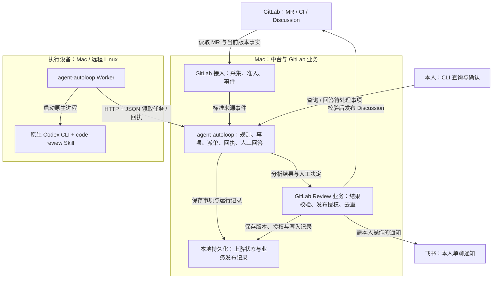

# 本地 Agent 自动化工作流 — 需求文档（PRD）

> **文档版本**：v1.1（agent-autoloop 需求基线）
> **更新日期**：2026-11-04
> **状态**：需求基线；实现完成情况以验收结果为准
> **选定底座**：[agent-autoloop](https://github.com/KKKKhazix/agent-autoloop)
> **首期场景**：GitLab 代码 Review，使用原生 Codex CLI
> **部署原则**：Mac 保存中台业务状态，Mac / 远程 Linux Worker 执行；不依赖自建云端状态服务

## 1. 目标与范围

在 agent-autoloop 上添加 GitLab 接入，自动发现符合条件的 MR，按配置选择 Worker、模型和审查 Skill，通过原生 Codex CLI 分析，并正确发布或交由本人确认 GitLab 评论。复用底座现成的事件、规则、事项、执行、回执与人工回答能力，避免再维护一套通用调度系统。

所有业务任务围绕 GitLab；GitHub 仅是开源项目托管位置，不是本系统的 MR、Issue 或交付来源。最终 Approve/Merge 始终由本人在 GitLab 操作。

### 1.1 首期必须具备

- agent-autoloop 作为唯一自动化底座，GitLab 业务通过扩展接入。
- GitLab 多 Group/Project 的 MR 扫描、手动指定 MR、Reviewer/CI/Draft 准入。
- Mac 和远程 Linux Worker 的配置化执行；139 是待配置的逻辑设备名，不视为已经可连接。
- 原生 Codex CLI、仓库级模型与既有 code-review Skill 选择。
- 结构化 Review、P0/P1/P2 评论、P3 仅报告、发布前校验与评论去重。
- CLI 查询及人工确认，飞书应用机器人向本人单聊发送需处理事项。
- 复用上游的任务与执行恢复机制，保留 GitLab 外部动作的业务一致性保证。

### 1.2 本期范围之外

| 项目 | 当前边界 |
|---|---|
| 其他 Agent 与直接模型 API | 本期只验收 Codex CLI；不建设直接调用模型 API 的 Runtime，不要求第二种 Provider |
| 管理面板 | 不建设 Web UI、问题列表编辑器、逐条勾选/全选与批量审批界面 |
| 定制断线处置 | 使用上游断线保留执行与恢复回报机制，不建设断线杀进程后重跑流程 |
| 通用平台重建 | 不另建调度引擎、Worker 协议、通用状态机或可视化工作流编辑器 |
| 自动开发与交付 | 不自动修改业务代码、Push、Approve、Merge 或部署；上游 GitHub 交付插件不纳入本项目业务范围 |
| Bug 分析、周报 | 保留扩展方向，不作为本期实现和验收任务 |
| 多人平台 | 不建设多租户、企业级权限管理或共享审计平台 |

人工确认、报告查询和发布授权使用 CLI 入口；本期不要求在飞书卡片中直接审批，也不要求提供自定义评论编辑和批量选择交互。

## 2. 复用边界与总体关系

下图是需求层的责任边界，不是已实现的组件接口设计。

- **上游负责**：事件与规则、事项跟进、Worker、原生 Codex 适配、执行回执、恢复、通道与人工回答基础能力。
- **我们负责**：GitLab 来源与准入、审查结果契约、GitLab 发布规则、跨版本问题关联、必要的 CLI 业务接入与配置。
- **既有工具负责**：Codex 执行模型分析；glab / GitLab API 访问 GitLab；lark-cli 与上游通道能力接入飞书。平台不自行转发模型 API 请求。
- **扩展原则**：优先采用上游插件和 HTTP + JSON 协议。必要的核心改动须由后续方案说明原因，不能默认另建完整底座。

具体上游版本、插件接口和部署配置由详细技术方案定义。

## 3. 平台、路由与执行要求

以下编号用于需求追踪与验收。

| 编号 | 需求 | 可验证标准 |
|---|---|---|
| SYS-01 | Mac 本地中台 | 业务状态保存在 Mac；无需自建云端状态服务；使用 agent-autoloop 启动和运行 |
| SYS-02 | 确定性路由 | 来源、事件类型及可信配置决定规则和目标 Agent；路由不依赖模型自由选择，能够解释命中配置 |
| SYS-03 | 设备、工具、模型分离 | 设备和模型可独立配置；本期工具仅 Codex CLI；不支持的组合明确失败 |
| SYS-04 | 本地与远程 Worker | 同一底座可向 Mac 和远程 Linux 派单；不强制通过自研 SSH 执行器派单；远端连接方式在部署方案确定 |
| SYS-05 | 原生 CLI | 实际调用已安装、已登录的 Codex CLI，不以同名模型 API 替代；不要求其他 CLI |
| SYS-06 | 无自动替换 | 失败时不自动切换设备、工具或模型；重试有上限，仍失败则形成可查询的需处理事项 |
| SYS-07 | 任务可追溯 | 可查询来源、MR 版本、规则、设备、模型、Skill、运行结果、报告和外部写入状态；不可得的模型/用量字段标未知 |
| SYS-08 | CLI 人工入口 | 可查看待确认事项、报告和目标版本，提交确认或拒绝；不依赖新建管理面板 |
| SYS-09 | 上游恢复语义 | 中台/网络暂时不可达不要求杀死 Worker 中的执行；恢复后可接收或查询既有执行结果，不因一次断线直接启动重复业务执行 |
| SYS-10 | 生命周期与资源 | 使用上游并发、超时和取消能力；取消或过期结果不能获得发布资格；未知状态不能标记成功 |
| SYS-11 | 扩展能力 | 后续可通过来源、规则、Skill 与结果处理接入 Bug 分析/周报，不因新增业务要求重写 Codex 适配器 |

规则先确定业务任务，再由配置选择目标 Agent/Worker。精确匹配及冲突优先级须在技术方案中映射到上游真实支持的规则，不新增通用路由协议。

同一设备可以配置不同模型的 Codex Agent；不同设备也可使用相同模型。配置是可信控制输入，MR 标题、描述和代码内容不能改变设备、工具、权限或收件人。

## 4. GitLab 任务发现与分析

### 4.1 准入与版本

| 编号 | 需求 | 可验证标准 |
|---|---|---|
| GL-01 | 自动发现 | 周期扫描授权范围内 Reviewer 包含本人的开放 MR，支持多 Group/Project 与分页，无新增任务不启动无意义的分析 |
| GL-02 | CI 准入 | 当前 Head SHA 的 CI 成功，或明确确认项目未配置 CI 时允许自动分析；Pending/Failed/Cancelled/Skipped 或未知状态不等于未配置 CI |
| GL-03 | Draft | Draft 不自动分析；转为 Ready 后即使 SHA 不变，也重新判断准入 |
| GL-04 | 手动指定 | CLI 可指定 MR URL/标识；显式选择时可覆盖 Reviewer、Draft、CI 门槛，但不能绕过权限、版本校验或发布策略 |
| GL-05 | 新版本与去重 | 任务关联 GitLab 实例、Project ID、MR IID、Head SHA 及有效策略；同一有效版本重复扫描不重复分析，Head 更新重新评估 |
| GL-06 | 仓库与环境 | 以稳定 Project ID 映射设备和仓库位置，避免同名仓库误路由；Review 对应精确 Head 与 Diff Base |
| GL-07 | 工作区与权限 | 分析默认只读，不改变开发分支和未提交改动；通过隔离代码快照/目录准备上下文，不把业务发布权限交给模型自由使用 |
| GL-08 | Skill 与上下文 | 沿用既有 code-review Skill，可绑定项目规范，按需读取相关调用链、测试与接口；上下文不足须请求补充，不得视为零缺陷 |

### 4.2 结果要求

每条 Finding 至少包括严重度、问题标题、依据、影响、建议、可定位的文件/行号及关联版本。报告区分已证实问题、有条件的风险与普通建议；保留原始分析和校验结果。

| 严重度 | 发布范围 |
|---|---|
| P0 | 纳入 GitLab 评论发布；遵守仓库的人工/自动策略 |
| P1 | 纳入 GitLab 评论发布；遵守仓库的人工/自动策略 |
| P2 | 纳入 GitLab 评论发布；遵守仓库的人工/自动策略 |
| P3 | 仅保留在报告，不发布 GitLab 评论；人工确认也不提升其发布资格 |

不能仅用不可解析的自由文本驱动自动发布。结构化结果不合法、分析失败或上下文未补全时，不允许宣称“没有问题”。无法精确定位的 Finding 保留摘要并注明限制，不能猜测 Diff 坐标。

## 5. 评论发布与人工决定

| 编号 | 需求 | 可验证标准 |
|---|---|---|
| PUB-01 | 仓库发布策略 | 默认人工确认；仓库明确开启自动发布后，合格的 P0/P1/P2 自动发布，P3 始终不发布 |
| PUB-02 | CLI 确认 | 用户能查看报告、准确的待发布内容和 Head SHA，再确认/拒绝；确认绑定目标版本与内容，任一变化使旧授权失效；不要求编辑、逐条勾选及批量操作界面 |
| PUB-03 | 发布前复核 | 再次确认 MR 开放、当前版本、有效 Reviewer/显式手动覆盖、合法 Diff 位置与发布授权；旧版本结果不得发布 |
| PUB-04 | 写入幂等 | 同版本同问题不重复创建 Discussion；请求超时先核对远端，无法判断时转人工，不盲目重复发送 |
| PUB-05 | 未解决旧问题 | 新版本再次检出同一未解决问题时关联旧 Discussion，不重复评论 |
| PUB-06 | 已解决问题复现 | 已解决的 Discussion 对应问题再次检出时转人工确认，不自动重开或重复新建；其他 Finding 独立遵守发布策略 |
| PUB-07 | 拒绝记忆 | 被拒绝的问题没有实质新证据时不反复提醒或发布；有新证据则重新请求确认 |
| PUB-08 | 发布身份 | 使用本人 GitLab 身份，正文标明自动化分析来源，保留远端 Discussion/Note 标识 |
| PUB-09 | 完成语义 | 分析完成、待确认、发布失败、发送结果未知、已发布分别可辨；不得把分析成功等同于发布成功 |
| PUB-10 | 人工最终审核 | 不自动 Approve/Merge，不自动改代码；最终 Review 由本人操作 |

自动发布指自动发送审查评论，不是发布应用、合并代码或批准 MR。人工确认入口的具体命令和与上游事项的映射留给技术方案定义，不能把上游通用回答能力当作上述发布校验已经实现。

## 6. 飞书通知

| 编号 | 需求 | 可验证标准 |
|---|---|---|
| NT-01 | 通知时机 | 仅在需要本人确认评论、补充资料、处理失败或做最终 Review 时通知；自动评论成功且仅等待作者修复时不通知 |
| NT-02 | 收件人与身份 | 使用配置的飞书应用机器人向本人单聊发送，不默认发送群 Webhook 或他人 |
| NT-03 | 内容与行动入口 | 包含 MR 链接、项目、版本、结果摘要、发布状态及下一步 CLI 操作指引；不依赖管理面板链接 |
| NT-04 | 重复控制 | 重复扫描同一未变化待处理事项不重复通知；发送状态未知可追查，不承诺外部通道天然恰好一次 |

本期复用已有 lark-cli 与可用的上游通道能力，仍需实际验证身份、权限及送达。不另建完整 IM 机器人交互产品，不要求在飞书直接审批。

## 7. 数据、恢复与安全边界

### 7.1 最小业务记录

| 记录 | 必须可关联的信息 |
|---|---|
| 来源与事项 | GitLab 实例、Project ID、MR IID、当前 Head、准入原因、上游事项标识 |
| 执行 | 上游运行标识、Worker、工具、配置模型、Skill、开始/结束、退出或未知原因 |
| 报告 | 分析版本、结构化 Findings、原始报告、校验状态 |
| 人工决定 | 决定人、时间、确认/拒绝、所绑定的版本与评论内容 |
| 发布 | Finding 标识、目标版本、幂等依据、发布状态、远端 Discussion/Note ID |
| 通知 | 需处理事项、内容版本、发送状态、远端消息标识（可获取时） |

以上为业务信息要求，不预设表结构或状态枚举。由后续方案明确哪些复用上游持久化、哪些是 GitLab 扩展数据，避免出现两个任务状态真相源。

### 7.2 恢复语义

- 连接中断本身不触发“停止远端—确认清理—重跑”流程。Worker 可继续执行，并遵循上游机制恢复联络、回报已有结果。
- Mac 恢复后重新核对 GitLab 当前状态；离线期间生成的结果仍须经过发布前校验，旧 SHA 结果不能因执行成功而发布。
- 不承诺模型进程恰好执行一次；业务目标是避免重复评论和错误版本发布。
- 中台状态、Agent 会话和 GitLab 写入分别可辨。执行未知、发布未知不能伪装成失败后直接重做外部动作。
- 用户主动取消、超时处置和业务发布去重仍须有效。

### 7.3 安全与权限

- 凭据保留在使用它的受信环境，不写入事件正文、提示词、报告和普通日志。
- 只在授权的仓库、目录、模型与设备范围执行；外部内容视为资料，不作为控制配置。
- 只读不等于密钥隔离。仍须验证分析权限与敏感凭据访问边界，不能将上游 `read` 配置视为已经满足隔离要求。
- 优先采用现成的 CLI 权限机制和操作系统隔离方式，不自研通用沙箱；实际保证范围须在技术方案中明确。
- 不修改开发工作区的现有未提交更改。

## 8. 首期验收

本表是需求的可观测验收口径，不是执行计划，也不是已通过的测试报告。实际命令、协议和测试入口由后续技术方案提供。

| 场景 | 关联需求 | 通过标准 |
|---|---|---|
| Mac 启动与状态恢复 | SYS-01、SYS-07 | agent-autoloop 为实际底座，重启后可查询既有事项、结果与发布记录 |
| 本地与远程 Codex | SYS-03–06、GL-06 | 两类设备分别执行真实 Codex，命中指定模型/Skill；失败不偷偷替换；不依赖其他 CLI |
| 规则与扩展边界 | SYS-02、SYS-11 | 相同输入和配置得到可解释路由；业务类型和设备/CLI 适配职责分离 |
| MR 扫描与准入 | GL-01–03 | 完成分页；Reviewer 与当前 SHA CI 正确过滤；无 CI 可准入；Draft 转 Ready 同 SHA 可重新判断 |
| 手动指定 | GL-04 | 显式覆盖项有效且可追溯，未覆盖的条件与权限、版本、发布规则仍生效 |
| 精确版本与工作区 | GL-05–08 | 重复扫描不重复分析；新 SHA 可重审；报告来自指定快照且开发工作区不变；缺失上下文明确阻塞 |
| 严重度和仓库策略 | PUB-01、PUB-02、PUB-10 | 默认经 CLI 确认；已开启仓库自动发布 P0/P1/P2；P3 不发布；不自动批准或合并 MR |
| 人工决定与无面板运行 | SYS-08、PUB-02、PUB-07 | 无管理面板即可查看、确认/拒绝；旧授权不可用于新版本/新内容；无新证据不重复请求被拒绝问题 |
| 发布位置与竞争 | PUB-03、PUB-08、PUB-09 | 错误位置、过期版本不发布；以本人身份标记自动化来源；失败与未知结果可查询 |
| 去重与跨版本问题 | PUB-04–06 | 超时先核查；未解决旧问题不重复发；已解决问题复现转人工 |
| 断线与迟到结果 | SYS-09、SYS-10、PUB-03–04 | 不要求断线杀进程；恢复已有执行，不因失联盲目重复业务任务；迟到旧结果不能发布 |
| 飞书本人通知 | NT-01–04 | 本人单聊收到需操作事项及可用 CLI 指引；等待作者修复不通知；重复扫描不重复提醒 |
| 权限与敏感数据 | GL-07、第 7.3 节 | 分析不改业务代码；凭据不进入资料/日志；实际权限边界有证据，未验证部分明确列出 |

## 9. 后续扩展

Bug 分析、周报及其他工作流只保留扩展方向；新增来源、数据授权、结果回写范围与验收标准另行确认，不纳入本期交付。

本 PRD 定义产品需求，[详细技术方案](docs/specs/local_agent_automation.md) 定义组件、协议与验收方式。执行计划不写入需求和技术方案；验证通过的正式扩展直接用于交付，不另造一次性演示实现。

参考上游：[协议](https://github.com/KKKKhazix/agent-autoloop/blob/cecec75be3ca26e6ca1d6833b50152ee9450088d/docs/protocol.md)、[插件](https://github.com/KKKKhazix/agent-autoloop/blob/cecec75be3ca26e6ca1d6833b50152ee9450088d/docs/plugins.md)、[安全边界](https://github.com/KKKKhazix/agent-autoloop/blob/cecec75be3ca26e6ca1d6833b50152ee9450088d/SECURITY.md)。
