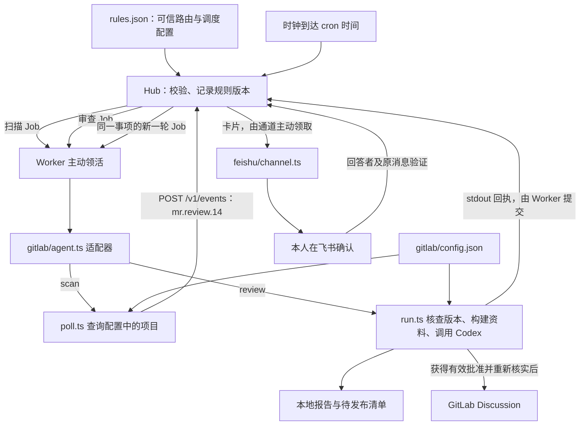

# rules.json 如何驱动 GitLab 审查

本文对应单机部署：一个 `up` 进程同时运行中台、接单程序和飞书通道。虽然在同一台 Mac 上，它们仍通过 HTTP 协议交互。`rules.json` 是可信的调度配置，不是给模型直接阅读的提示词文件，也不是一个独立运行的定时脚本。

## 先区分三份配置

| 文件（相对实例数据目录） | 管什么 | 谁读取 |
|---|---|---|
| `config.json` | 本机启动哪些角色、Hub 地址、Worker 名称与容量、密钥、飞书收件人等 | `host/up.ts`、各通道 |
| `rules.json` | 来源、Agent、通道的登记，以及何时派活、派给谁、并发与通知策略 | `host/runtime.ts` 加载，内核按规则决策 |
| `gitlab/config.json` | GitLab 实例、项目白名单、本人 Reviewer ID、模型、缓存和发布策略（旧 CI 字段仅兼容读取）等 | GitLab 插件 |

实例的 `bin/agent-autoloop` 包装器固定设置 `AGENT_AUTOLOOP_HOME`。`host/home.ts` 据此定位 `config.json` 和 `rules.json`；也支持显式 `AGENT_AUTOLOOP_RULES` 覆盖规则文件位置。程序位于实例 `app/`，数据位于 app 外；源码仓库不是在线实例的程序目录。

## 整条链路



箭头中的 Job 表示执行请求，事件和回执表示数据。内核自己不访问 GitLab、不启动模型，也不向飞书发请求。

## 从启动到第一次扫描：控制流

1. `bin/agent-autoloop.ts` 进入 `cli/main.ts`。执行 `up` 时调用 `host/up.ts`，读取本机配置并启动 Hub、Worker 和配置的通道。
2. `host/runtime.ts` 读取规则；`protocol/rules.ts` 校验字段、Agent 引用、来源、cron、目录、并发等。有效变更被记成规则事实及版本。
3. `host/server.ts` 根据下一次到期时间设置计时器；到期后把当前时间传给 `kernel/decide.ts`。内核不直接读取时钟。
4. `decide.ts` 的 `tick` 检查 `when.cron`。`*/5 * * * *` 表示每小时第 0、5、10……55 分钟，不是从程序启动时起隔 300 秒。时间到了就记录 `schedule.tick` 并排入对应规则的队列。
5. `worker/worker.ts` 用 Worker 密钥向 `GET /v1/work` 主动领活。Hub 根据登记的 worker 名称、队列状态和组并发限制返回 Job；本机 Worker 的 capacity 还限制这台机器同时接多少活。
6. `kernel/query.ts` 的 `jobOf` 将规则、Agent 参数、事件资料与回答组装成 Job，并附本轮 token。Worker 保存任务和 `context.json`，再加载 `agent.use` 指定的适配器。
7. `host/plugins.ts` 按标准路径查找插件：实例 `plugins/<name>/agent.ts` 优先，其次安装包内置同路径。`use: gitlab` 因而找到 `plugins/gitlab/agent.ts`。
8. 适配器将 `command: ["scan", "--config", "gitlab/config.json"]` 转成当前 Node 执行安装包内 `poll.ts`。这不是直接交给 shell 的任意命令；该适配器只接受规定的 scan/review 参数形态。

扫描阶段不调用模型。它查询 GitLab，并通过 Codex 原生目录接口读取配置和 Skill 依据，判断条件后提交来源事件。

## 扫描发现 MR 后：数据流

`poll.ts` 读取项目白名单，遍历各项目打开的 MR，再检查非草稿、Reviewer 和有效 head；不检查 CI。项目 ID 决定查哪个远端项目，缓存目录不负责选项目。

对合格 MR，插件生成并持久化请求，再向中台提交事件。以 示例项目 !80 为例，其关键内容形如：

```json
{
  "type": "mr.review.14",
  "subject": "work/14/80",
  "detail": "请求标识、projectId、mrIid、headSha、policyHash 等的 JSON"
}
```

来源身份由请求使用的来源密钥确定，不能由事件正文冒充。Hub 用 `when.source: gitlab` 和 `when.types: [mr.review.14]` 匹配规则；事件中没有“执行这个程序”“切换这个目录”之类的权限。

`subject` 区分具体 MR。自动派发按 MR head 去重：同一已投递版本不会因其他条件改变重复投递，只有新 head 才产生新的自动审查。Hub 自身也按来源与事件 ID 去重；业务去重和中台去重各守一层。

匹配后 Hub 记录事件、创建或合并排队的轮次。Worker 执行 run.ts，核对项目和 MR 版本、更新专用 main 工作目录，然后启动原生 Codex，发送可信 prompt 和 MR 链接。Codex 自己按 Skill 读取 MR；插件不下载 Diff 或准备 MR Git 对象、上下文副本。

报告记录本轮 main commit、`rules.prompt`、Codex 原生 Skill catalog 与依据摘要；只有 MR head 变化才触发新审查；其他依据变化只在下一次新 head 审查时生效。Codex 在专用工作树按原生机制读取仓库规则与 Skill；完整代码资料和报告留在私有目录，不塞进中台事件。Worker 将事件原文保存为资料，MR 文字不会成为指令。

## rules.json 中各字段的作用

| 字段 | 当前例子 | 实际含义 |
|---|---|---|
| `sources.gitlab` | `name: GitLab` | 登记来源及展示名；不会单凭这一项开始扫描，也不包含密钥 |
| `agents.gitlab-scan` | 一个 Agent 标识 | 描述扫描任务怎样执行；名字可以改，但所有引用须一起改 |
| `agent.worker` | `mac-worker` | 交给哪个 Worker 身份，必须与本机配置匹配 |
| `agent.use` | `gitlab` | 用哪个适配器解释 command、读取结果 |
| `agent.command` | `scan/review --config ...` | 适配器接受的业务参数；相对配置路径基于实例数据目录 |
| `agent.timeout` | 120 / 1800 | 单轮执行时间上限，单位秒；不是扫描间隔 |
| `channels.feishu` | name、answerers | 登记通道和允许回答的人；实际收件人、通道密钥在本机 config 中 |
| `rule.name` | `gitlab-review-14` | 规则及事项身份，不是特殊内置名称，避免为了美观随意改名 |
| `rule.when` | cron 或 source/types | 时间触发与来源事件触发两种入口 |
| `rule.to` | `gitlab-review` | 引用 agents 中的一个 Agent |
| `rule.cwd` | 私有目录 `gitlab/work` | 业务脚本启动目录；不是 APP 开发仓库，也不是 Codex 的 main 审查工作树 |
| `rule.group` | `gitlab-review` | 多条规则可共用的并发限制组 |
| `rule.parallel` | 1 | 按 subject 分开事项，同时该组最多一轮执行；不写时该规则合为一条执行线，组默认上限仍为 1 |
| `rule.tell` | `needed` | 不为每次完成额外通知；仍处理需要人的 ask/notice |
| `rule.prompt` | 固定中文描述 | 实际审查的唯一可信任务指令；Codex 在专用工作树中原生解析 Skill，仅在真正的新 head 审查开始时使用当轮可信输入 |

扫描与审查是两个 group，组限制本身并不让它们互相排斥；当前本机 capacity 为 1，因此仍会串行。审查占用 Worker 时，到点的扫描任务会排队；5 分钟是触发周期，不保证忙碌时每 5 分钟完成一次查询。`parallel` 改大而 capacity 保持 1，也不会让这台机器同时运行多个任务。

## 报告如何到飞书，回答如何回来

`run.ts` 保存报告，再输出业务结论与可选 `agent-autoloop` 回执。Worker 用 `worker/contract.ts` 解析，并通过本轮 token 提交 `POST /v1/runs/<run>/result`。

若有待发布评论且采用 manual，回执包含 ask：让本人选择发布或不发布。Hub 记录卡片。`plugins/feishu/channel.ts` 主动领取卡片，调用 lark-cli 发送或更新消息，再将飞书 message ID 回报 Hub。

点击卡片后，通道携带选项、回答人身份和消息 ID 提交回答。`kernel/decide.ts` 检查 `channels.feishu.answerers` 和已发送的原消息，重复回答不重复生效。合法回答被记录，并直接唤醒卡片所属的原规则；不需要另配 `card.answered` 路由。

下一轮 `run.ts` 读取回答，验证它绑定的待发布清单和当前事实；每条发布前核对当前项目身份、MR head、Reviewer 和批准范围，才可能创建 GitLab 评论。MR 状态核对与 GitLab 写入不是同一个远端事务，因此发送后还会核实，发现变化要交本人处理已发到旧版本的评论。等待人时，上一轮早已结束，不占模型进程。通道并不直接把点击转为 GitLab 写入。

审查完成后，findings 通过通知或确认卡片发送；零 findings 也会产生结果通知。`tell: needed` 不额外发送通用完成摘要；无需为了收到审查结果改成 `always`，否则可能出现重复摘要。扫描规则也无需每次通知。

## 规则修改如何生效，历史怎么保留

`host/server.ts` 监听规则文件所在目录，修改后触发 `tick`；`host/runtime.ts` 重新读取并校验。有效修改进入事实日志并使用新版本；运行中的任务保留领取时的 Job，新领取任务按当时有效规则派发。校验错误时不替换已有有效规则，并记录需处理的问题。首次启动没有任何有效规则则无法正常启动。

`host/runtime.ts` 的 execute 在事务里调用 `kernel/decide.ts`；`kernel/store.ts` 负责提交事实，`kernel/evolve.ts` 更新持久投影，数据保存在实例 `hub.db`。规则版本、事件、轮次、卡片、回答是可追溯的事实，不是重启即丢的内存状态。GitLab 完整报告、清单和外部动作记录另存于 `gitlab/data`。

常用排查顺序：

```sh
agent-autoloop check         # 通用规则能否被接受
agent-autoloop gitlab check  # GitLab 私有配置、本地程序和缓存是否就绪
agent-autoloop doctor        # 系统服务、中台、Worker 和通道是否在线
agent-autoloop status        # 队列、最近轮次和下一次定时
agent-autoloop why 12        # 第 12 轮经历了什么
```

配置里的模型、项目、规范属于 GitLab 插件；cron、路由、并发属于中台。沿这个分工修改，就能避免将“没有派出任务”和“任务内部审查失败”混为一谈。


GitLab 项目可设置 `publication: "severity"`：P0/P1 自动发布且不发送正常结果通知，P2 通过飞书确认后发布；混合报告分开处理，P3 仅告知。零 findings 仍发送带 MR 链接的通知，提示继续人工 review / 审核。所有模式均以普通 Discussion 发布，保留文件与行号；执行异常单独处理。旧 `manual` / `auto` 模式保留。

自动重审只由 MR 提交版本（head SHA）变化触发。已投递的同一 head 不因 main、prompt、Skill、模型、发布配置、Reviewer 或 CI 状态变化再次派发。首次尚未满足准入的 MR，在合格后首次启动。真正审查任务开始时才更新 main 工作目录并加载可信 Job 指令；扫描不更新工作树或枚举 Skill。同一 head 复用最新已完成报告及其内容摘要，不改写时间和请求编号来制造新报告。main、prompt、Skill 和模型保留为审计依据，不用于使同一 head 的报告或批准失效。发布仍核对 MR head、当前项目身份、Reviewer 和明确授权；切换分级发布只重新分流已有 findings，不重新调用模型，旧的整份人工清单不会自动获得 P2 发布权限。