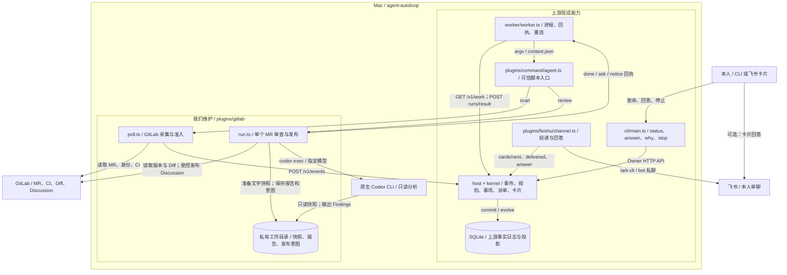
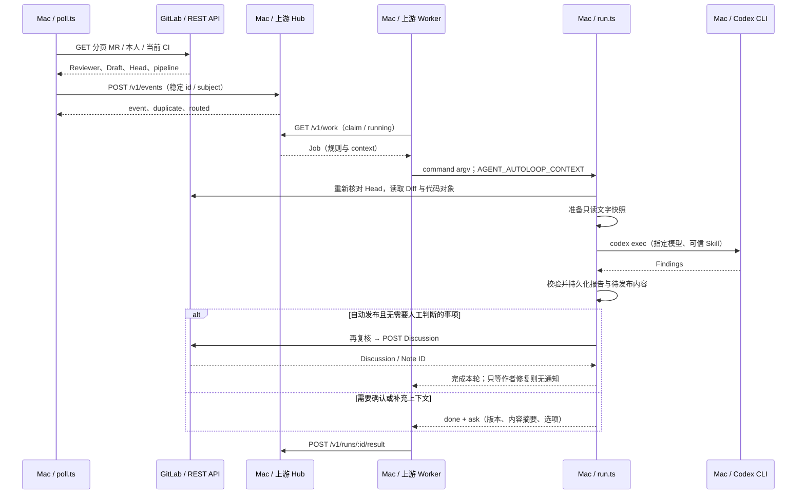
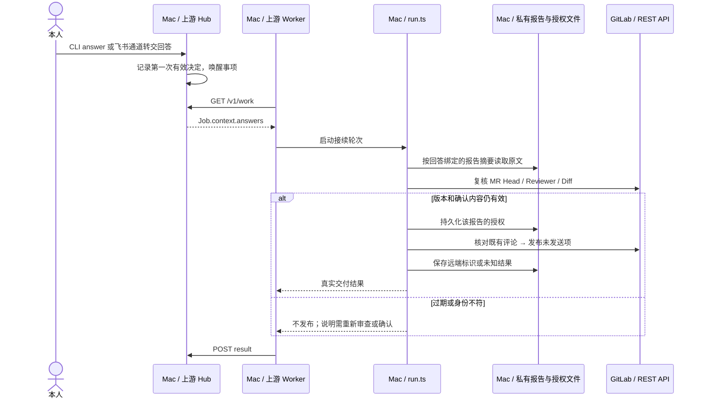

# agent-autoloop GitLab Review 方案

**状态：范围调整提案，等待用户审批；尚非实施定稿。**

目标是尽量复用 agent-autoloop，用最少改动跑通 GitLab Review。当前有效需求见 [PRD](../../Local_Agent_Automation_PRD_v1.0.md)。下文的范围收缩尚未获批，不自动覆盖 PRD；审批后同步修改需求和本方案，再定义新增业务接口的最终字段与验收细节。本轮不开始代码实现。

上游源码基线：`cecec75be3ca26e6ca1d6833b50152ee9450088d`。交付形态是 agent-autoloop Fork 加 GitLab 业务扩展，不另建调度平台。

## 1. 建议审批的范围

推荐整体采用以下调整。目的不是放弃发布正确性，而是先减少设备、交互和恢复策略的组合。

| 项目 | 当前 PRD | 本次推荐 | 收益与明确限制 |
|---|---|---|---|
| 首期设备 | Mac 与远端 Linux 都须验收 | **先只跑 Mac**；远端沿用上游 Worker，后续再配置验收 | 不做跨设备报告传输、凭据分配和远端故障验证；保留设备扩展能力 |
| 失败重试 | 所有失败必须有最终次数上限 | **沿用上游重试策略**；可识别的业务阻塞用 ask 交给本人 | 不修改内核；未捕获异常仍可能持续退避重试，上游第三次失败通知不是停止 |
| 人工确认 | 专门的报告查询与发布确认契约 | **复用上游 status / answer / ask**，按一份报告确认 | 不开发新的审批 CLI、编辑器或批量操作；每份报告的批准仍绑定版本和内容 |
| 跨版本问题记忆 | 自动关联未解决、已解决复现、拒绝证据 | **首期只保证同 MR、同 SHA、同条评论不重复**；跨版本相似问题交人判断 | 不开发语义关联和跨版本拒绝记忆；新 SHA 不承诺自动识别同一个问题 |
| 权限验收 | 单独认证复杂的跨设备权限边界 | **先复用上游快照审查与 Codex 权限方式**，做实际只读冒烟 | 不研发沙箱；只读不等于无法读取本机其他文件，强凭据隔离不作为首期已保证能力 |
| 通知与运行语义 | 定制通知通道与完整业务状态表达 | **使用上游飞书通道和卡片**，接受其通知、回答与恢复语义 | 不新增仅通知 channel；可使用现有卡片回答，首期不另设专门交互协议 |

不变的业务边界：GitLab 为唯一业务来源；原生 Codex CLI；规则选择执行器；Reviewer 为本人、当前 SHA CI 成功或已明确无 CI、Draft 跳过；P0/P1/P2 纳入评论，P3 不发布；仓库默认人工确认，明确开启后自动发布；不自动改代码、Approve、Merge 或部署。

不变的正确性底线：当前版本复核、合法 Diff 坐标、人工授权绑定内容、发送未知不盲重发、凭据不进入提示词和日志。缩小范围不表示这些检查交给模型随意判断。

**本次审批只决定上述范围。** 真实 MR、发布权限和飞书收件人仍是部署配置，本文不授权向任何真实对象发送测试评论或消息。

## 2. 顶层架构

### 2.1 首期目标结构

图中 `plugins/gitlab/` 为拟新增路径，其余为当前可定位的上游组件。首期在一台 Mac 上把采集、分析、人工接续和发布串起来；报告留在同机私有目录，不用事件分片搬运全文，不需要额外 Artifact 服务。

### 2.2 组件职责与复用边界

| 组件 | 责任 | 不承担的责任 |
|---|---|---|
| poll.ts | 分页读取授权项目，确定 Reviewer/Draft/CI，发稳定 ID 的来源事件 | 不调用模型，不改代码，不发布评论 |
| run.ts | 核对 MR 版本，准备快照，运行 Codex，校验结果，生成 ask，校验回答，发布合格评论 | 不自建队列、Worker、并发槽位或失败计数 |
| 私有工作目录 | 保存报告原文、确定的待发布文本、版本绑定和写入意图，供同机恢复 | 不保存另一套运行状态机，不替代上游事实日志 |
| Codex CLI | 基于可信 Skill 与代码资料产出 Findings | 不持有 GitLab 写入身份，不决定授权，不自行调用发布 API |
| 上游 Hub / Worker | 事项、路由、执行、重试、回答、停止与重连 | 不理解 GitLab 或严重度，不做语义问题关联 |
| 上游飞书通道 | 现成卡片、本人回答验证与消息更新 | 不新增产品面板 |

使用现有 `use: command` 启动脚本；不需要新增插件发现方式。业务代码只用 Node 自带模块及自身目录文件。原生 Codex 参数和快照处理以 [普通适配器](../../plugins/codex/agent.ts) 与 [现有审查实现](../../plugins/delivery/review.ts) 为参考，不启用 GitHub 合并发布流程。

采用上游飞书通道前必须确认同一应用没有其他卡片监听占用；这是现有通道的运行约束，不另写一套回调系统来绕过。

## 3. 路由与配置

上游根据 `when.source + when.types` 匹配规则，再由规则的 `to` 指定 Agent，由 Agent 的 `worker` 指定设备。模型不参与路由。

拟为每个启用项目配置独立 review 规则：

- 来源：`gitlab`。
- 类型：`mr.review.<projectId>`，由可信采集代码生成。
- subject：`<instanceKey>/<projectId>/<mrIid>`，不含 Head，使同 MR 归入同一事项。
- Agent：首期 Mac 上的 GitLab 业务脚本，内部只启动指定的 Codex CLI。
- `parallel: 1`：保守串行开始；后续按上游 group/worker capacity 调整，不新增调度器。
- `model`、`effort`、目录、Skill、发布模式和实例地址来自可信配置，不读取 MR 正文中的指令。

上游允许多条规则匹配同一事件，所以配置验收必须保证每个 review 类型只命中一条审查规则，不假设存在“第一条胜出”的优先级。

GitLab 实例、Project ID、本人账号、CLI 路径、Skill 路径、模型、仓库发布模式与明确无 CI 的配置由部署填写。密钥由已有 CLI/私有配置管理，不写进规则示例或仓库。

## 4. 单个 MR 的业务过程

### 4.1 自动发现与首次分析

定时规则运行 poll；准入通过后投递来源事件，Mac Worker 启动审查脚本。

采集脚本作为受信来源客户端直接调用 `/v1/events`，收到接受响应后再推进本地观察记录；响应丢失重发同一个 id。200 且 routed 为空属于配置问题，不能当已开始审查。自动发现事件的 ID 必须区分 Head 与准入条件变化，避免 Draft 转 Ready 同 SHA 被永久忽略。

run.ts 以 GitLab 最新事实判断业务；上下文中的多个同 MR 事件可能由上游合并，不假设一轮只有一个事件。同一轮只处理当前有效版本，其他版本留过期说明。

### 4.2 人工回答后接续

用户在 CLI 或现成飞书卡片确认，回答触发新一轮；不让原进程一直等待本人。

回答轮可能没有原事件和报告正文，因此恢复依赖已保存的不可变报告与摘要绑定。批准一旦保存，可用于恢复同份报告中未完成的动作；不能要求每次恢复都重新出现 context.answers。内容、Head、策略变化使旧授权失效。

补充上下文不是发布授权；补充后重新分析，不能把 needs-context 报告作为已完成缓存。批准的具体报告字段与文件原子写入格式在范围批准后的详细契约中定稿。

### 4.3 中断与副作用

沿用上游 Worker 断线继续执行、落盘后重交结果。整台 Worker 失联与在线 Worker 漏报某轮的语义不同；上游可能接受迟到结果，因此不能承诺模型只执行一次。

每条评论发送前保存确定的版本、内容摘要和 actionKey；恢复先核对 GitLab。若进程在发送后、保存响应前退出，状态视为未知，不直接重复 POST。上游 `done` 仅表示该轮结束，不能代表所有评论已经成功。

主动停止仅取消指定上游运行，不承诺撤回已提交到 GitLab 的评论。版本失效、用户拒绝或停止后未执行的动作不能继续发出；具体停止与发布竞争的验收在正式契约中明确，不把“杀进程”当事务回滚。

## 5. 既有接口与拟新增业务契约

### 5.1 复用上游接口

完整字段、鉴权、成功与失败响应引用 [协议](../protocol.md)、[Schema](../../protocol/schema.json) 和 [校验实现](../../protocol/validate.ts)。本提案不修改以下协议：

| 场景 | 入口 | 身份与约束 |
|---|---|---|
| 采集事件 | POST /v1/events | source key；同来源 id 去重；返回 event/duplicate/routed |
| 派单与心跳 | GET /v1/work | Worker key；claim 重放、running、capacity、cancel 按上游 |
| 完成一轮 | POST /v1/runs/:id/result | 本轮 token；重复同结果可重放，不同结果冲突 |
| 人工回答 | POST /v1/cards/:id/answer | owner 或受限 channel；choice 与 text 按上游规则 |
| 状态/解释 | GET /v1/state、GET /v1/runs/:id/why | owner；CLI 走相同接口 |
| 通知投递 | cards/next、delivered、failed | channel；version/ref/重试按上游 |

事件 `detail` 最多 4,000 字符，回执 events 最多 100 项，HTTP body 上限 1 MiB。首期不把完整审查报告通过 events 传输，仅传 MR 标识与版本；报告保存在 Mac。卡片正文超过上游限制时保留摘要与完整报告路径，不静默截断待批准文本，也不把摘要当成全文。

### 5.2 GitLab 业务契约的拟定范围

GitLab 插件需要定义以下小范围结构，范围批准后补齐逐字段约束、完整示例与错误码；这些结构尚未实现，不可直接据此开展编码。

| 结构 | 必须表达的内容 | 信任边界 |
|---|---|---|
| MR 来源事件 | 实例配置键、Project ID、MR IID、Head、观察版本 | 不允许指定任意主机、命令、工作目录或权限 |
| 审查报告 | 精确 Diff 版本、模型/Skill、状态、Findings、缺失资料 | 模型只能填分析内容；可信版本由脚本写入 |
| Finding | P0–P3、文件/侧/行号、依据、影响、建议 | Diff 定位由脚本校验；P3 永不发布 |
| 待确认报告 | 报告摘要、Head、精确评论文本/位置摘要 | 回答仅授权该版本内容；自由文本不能隐式批准 |
| 发布记录 | actionKey、intent/unknown/sent、远端 ID | 网络未知先查 GitLab，不重复副作用 |

同版本 actionKey 使用实例、MR、Head 与规范化 Finding/评论内容计算，并在评论中加入自动化标记；查询需同时核对作者和内容，不只认他人也能复制的标记。跨版本语义关联不纳入建议首期范围。

GitLab 读取、Diff 坐标和创建 Discussion 采用现有 [Merge Requests API](https://docs.gitlab.com/api/merge_requests/) 与 [Discussions API](https://docs.gitlab.com/api/discussions/)，不改 GitLab 服务端。鉴权由已有 glab/受控客户端管理。API 无当前 Head 的原子条件写保证，发送前后的竞争窗口如实记录，不承诺跨系统事务。

## 6. 对外变更与兼容

| 项目 | 上游基线 | 建议首期 | 影响 |
|---|---|---|---|
| HTTP、Job、Result | 已有统一协议 | 不变 | 现有 Worker、内核、其他插件无须适配 |
| GitLab 采集与审查 | 无专用业务 | 增加 scripts/command 形式的业务扩展 | 只注册来源、Agent 和规则 |
| 飞书通道 | 已有卡片与本人回答 | 直接使用 | 不新增通知通道或审批服务 |
| 内核重试 | 退避、连续第三次通知、无最终次数上限 | 接受现成语义（待审批） | 无 maxAttempts 字段或内核修改 |
| 本地文件 | Worker journal 与上游数据库 | 业务仅补报告、授权和外部动作记录 | 不建第二套运行队列或迁移上游表 |

首期没有 GitLab 旧客户端需要兼容，不引入版本兼容层。业务配置和数据不提交到公共 Fork。其他上游功能和文档保留原样，不因本项目不用而删除。

## 7. 验收矩阵

范围获批后成为正式验收输入；目前未执行这些验证。L0 静态/单元，L1 本机集成，L2 假业务服务，L3 真实设备脚本驱动。拟定入口尚不存在，不宣称是已有命令。

| 场景 | 级别 | 入口 | 可观测通过标准 |
|---|---|---|---|
| 上游协议未变 | L1 | 已有 tests/conformance.test.ts | 既有接口、鉴权、重放通过 |
| 准入、分页与规则 | L2 | 拟定 tests/gitlab-poll.test.ts | Reviewer、Draft、当前 CI、无 CI 配置均正确；多页无遗漏、无重复派单 |
| 原生 Codex 与快照 | L3 | 拟定 GitLab Review 冒烟入口 | 真实版本、argv、精确 SHA、只读快照及完整结果；不运行 MR 代码 |
| 人工回答接续 | L1 | 拟定 tests/gitlab-review.test.ts | answers-only 可恢复；旧 SHA/变更内容/自由文本不授权 |
| 同版本发布去重 | L2 | 拟定 tests/gitlab-publish.test.ts | 超时/崩溃先核查，同条评论不盲重发；P3 不发 |
| 当前版本与 Diff 位置 | L2 | 同上，假 GitLab 并发变更 | 合法坐标才发布；过期不发；竞争窗口已发旧版本如实标记 |
| 上游恢复与业务阻塞 | L1 | 已有 Worker 测试加拟定 GitLab 接续用例 | 断线恢复不重做已知副作用；业务阻塞交本人，不自动切换模型 |
| 飞书与最终真实闭环 | L3 | 指定测试 MR、本人单聊、现有 channel | 真实消息和 Discussion ID 可追溯；只在明确授权对象上执行 |

纯文档工作只核对源码引用、Markdown/Mermaid 结构及 Git 差异，不安装依赖或启动服务。代码阶段按仓库规定执行相关测试、typecheck 和 format 检查。

## 8. 审批后需要定稿的内容

先批准第 1 节的范围调整，再将其同步到 PRD；随后在本文件补齐新增业务结构、命令、文件原子性和测试入口的最终契约。只有用户进一步授权实现后才开始写代码。

实际 GitLab 版本、Codex 参数支持、本人身份与飞书权限仍须运行验证。它们不改变“先 Mac、使用现成底座、只补 GitLab 业务”的建议，不以假测试结果冒充真实闭环。
