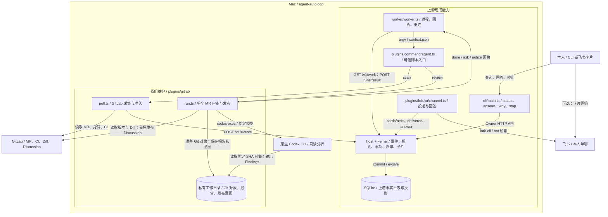
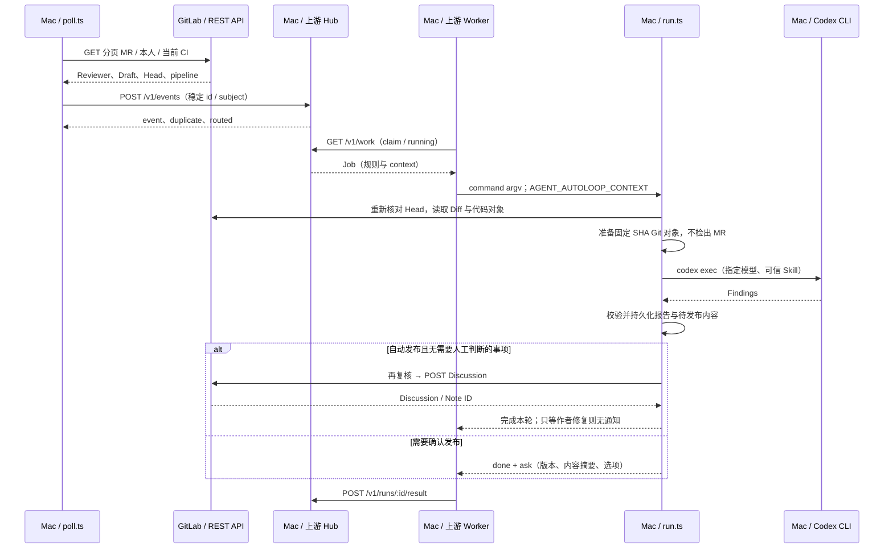
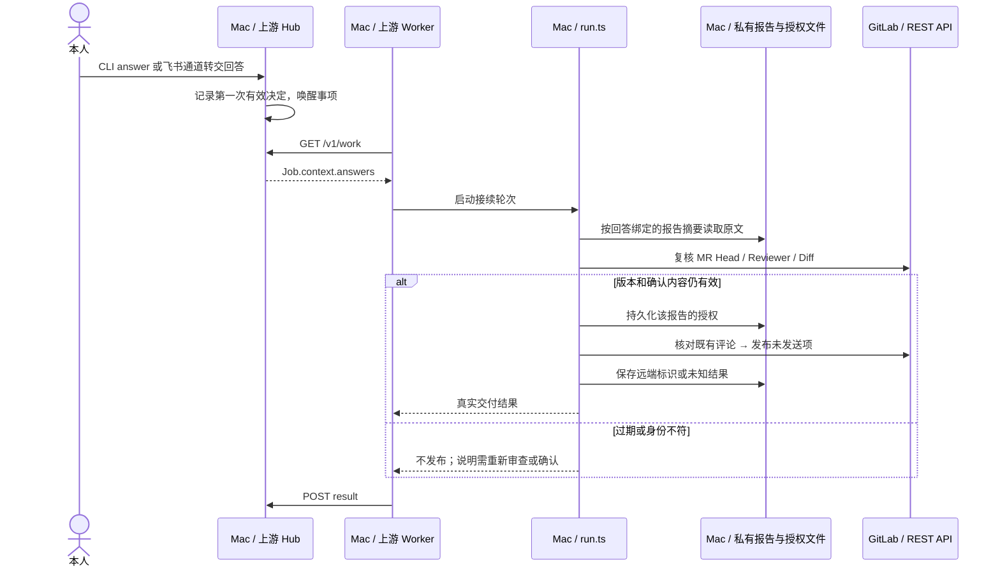

# agent-autoloop GitLab Review 方案

**状态：已实现并在本机部署。当前采用每仓库唯一 main 审查工作树和 Codex 原生配置；验证范围见 [验证记录](local_agent_automation_evidence.md)。**

**实施合同：**每个项目只使用一份专用的 `codereview-worktree`，从已配置裸缓存的可信远端 `main` 分支获取最新 commit；不存在时创建，存在时更新到该 commit。Codex 在该目录按原生机制读取仓库规则与 Skill，并执行唯一可信 `rules.prompt`；MR 标题、描述、版本和差异只是隔离资料。日常开发目录不 pull、reset 或切分支；不增加锁、并发协调、版本共存或调度。审查只读，不执行 MR 代码、测试、hooks 或发布。每轮记录实际 prompt、MR 与 main SHA；main/prompt/model 等依据变化使旧缓存和批准失效。旧 GitLab `skill`、`skillPath`、`projects.rules` 与 GitLab `rule.skill` 不兼容，必须移除。

目标：复用 agent-autoloop，在 Mac 上以最少业务扩展跑通 GitLab Review。有效需求见 [PRD v1.2](../../Local_Agent_Automation_PRD_v1.0.md)。本文件定义实施契约，不代表验收已经完成。

上游源码基线：`cecec75be3ca26e6ca1d6833b50152ee9450088d`。交付形态是 agent-autoloop Fork 加 GitLab 业务扩展，不另建调度平台。`plugins/gitlab/` 是本机业务扩展；其他引用路径为上游组件。

## 1. 已确认范围

| 项目 | 首期设计 | 保证边界 |
|---|---|---|
| 设备 | 只验收 Mac；远端后续沿用上游 Worker | 不建设跨设备传输或做远端验收 |
| 重试与恢复 | 上游退避重试，第三次失败通知；业务阻塞用 ask | 无最终重试次数上限，不修改内核 |
| 人工确认 | 现成 status / answer / ask 与飞书卡片，按报告确认 | 不新增审批 CLI、编辑或勾选界面 |
| 去重 | 同 MR、同 SHA、同条评论不重复 | 跨版本相似问题交本人判断，不建设语义关联和拒绝记忆 |
| 权限 | 按本机 Codex 原生配置执行只读审查任务 | 不额外覆盖用户配置，不承诺插件提供沙箱隔离 |
| 通知 | 上游飞书通道与卡片 | 接受现成投递、回答、恢复语义，不新增 channel |

保留 Reviewer/当前 SHA CI/无 CI/Draft 门槛；项目可显式允许当前 SHA 的 skipped CI、指定原生 Codex 与 Skill、精确版本和 Diff 位置校验。仓库默认人工确认；开启自动发布后发送合格 P0/P1/P2，P3 不发布。不自动改代码、Approve、Merge 或部署。

GitLab 目标项目、本人身份、模型和飞书收件人属于部署配置；真实写入验证只对明确授权的测试对象执行。

## 2. 顶层架构

### 2.1 首期目标结构



图中 `plugins/gitlab/` 为本机业务扩展，其余为上游组件。首期在一台 Mac 上把采集、分析、人工接续和发布串起来；报告留在同机私有目录，不用事件分片搬运全文，不需要额外 Artifact 服务。

### 2.2 组件职责与复用边界

| 组件 | 责任 | 不承担的责任 |
|---|---|---|
| poll.ts | 分页读取授权项目，确定 Reviewer/Draft/CI，发稳定 ID 的来源事件 | 不调用模型，不改代码，不发布评论 |
| run.ts | 核对 MR 版本，准备 Git 对象，运行 Codex，校验结果，生成 ask，校验回答，发布合格评论 | 不自建队列、Worker、并发槽位或失败计数 |
| 私有工作目录 | 保存报告原文、确定的待发布文本、版本绑定和写入意图，供同机恢复 | 不保存另一套运行状态机，不替代上游事实日志 |
| Codex CLI | 基于可信 Skill 与代码资料产出 Findings | 不持有 GitLab 写入身份，不决定授权，不自行调用发布 API |
| 上游 Hub / Worker | 事项、路由、执行、重试、回答、停止与重连 | 不理解 GitLab 或严重度，不做语义问题关联 |
| 上游飞书通道 | 现成卡片、本人回答验证与消息更新 | 不新增产品面板 |

使用现有 `use: command` 启动脚本；不需要新增插件发现方式。业务代码只用 Node 自带模块及自身目录文件。原生 Codex 调用见 [GitLab 调用器](../../plugins/gitlab/codex.ts)，固定 SHA 的对象准备见 [对象入口](../../plugins/gitlab/objects.ts)，不启用 GitHub 合并发布流程。

采用上游飞书通道前必须确认同一应用没有其他卡片监听占用；这是现有通道的运行约束，不另写一套回调系统来绕过。

## 3. 路由与配置

上游根据 `when.source + when.types` 匹配规则，再由规则的 `to` 指定 Agent，由 Agent 的 `worker` 指定设备。模型不参与路由。

拟为每个启用项目配置独立 review 规则：

- 来源：`gitlab`。
- 类型：`mr.review.<projectId>`，由可信采集代码生成。
- subject：`<instanceKey>/<projectId>/<mrIid>`，不含 Head，使同 MR 归入同一事项。
- Agent：首期 Mac 上的 GitLab 业务脚本，内部只启动指定的 Codex CLI。
- `parallel: 1`：保守串行开始；后续按上游 group/worker capacity 调整，不新增调度器。
- `model`、`effort`、目录、Skill、发布模式和实例地址来自可信配置，不读取 MR 正文中的指令。

上游允许多条规则匹配同一事件，所以配置验收必须保证每个 review 类型只命中一条审查规则，不假设存在“第一条胜出”的优先级。

GitLab 实例、Project ID、本人账号、CLI 路径、模型、仓库发布模式与明确无 CI 的配置由部署填写。密钥由已有 CLI/私有配置管理，不写进规则示例或仓库。

## 4. 单个 MR 的业务过程

### 4.1 自动发现与首次分析

定时规则运行 poll；准入通过后投递来源事件，Mac Worker 启动审查脚本。



采集脚本作为受信来源客户端直接调用 `/v1/events`，收到接受响应后再推进本地观察记录；响应丢失重发同一个 id。200 且 routed 为空属于配置问题，不能当已开始审查。自动发现事件的 ID 必须区分 Head 与准入条件变化，避免 Draft 转 Ready 同 SHA 被永久忽略。

run.ts 以 GitLab 最新事实判断业务；上下文中的多个同 MR 事件可能由上游合并，不假设一轮只有一个事件。同一轮只处理当前有效版本，其他版本留过期说明。

### 4.2 人工回答后接续

用户在 CLI 或现成飞书卡片确认，回答触发新一轮；不让原进程一直等待本人。



回答轮可能没有原事件和报告正文，因此恢复依赖已保存的不可变报告与摘要绑定。批准一旦保存，可用于恢复同份报告中未完成的动作；不能要求每次恢复都重新出现 context.answers。内容、Head、策略变化使旧授权失效。

需求与规范冲突作为 finding；不要求作者补充上下文。报告字段与文件原子写入按第 5 节执行。

### 4.3 中断与副作用

沿用上游 Worker 断线继续执行、落盘后重交结果。整台 Worker 失联与在线 Worker 漏报某轮的语义不同；上游可能接受迟到结果，因此不能承诺模型只执行一次。

每条评论发送前保存确定的版本、内容摘要和 actionKey；恢复先核对 GitLab。若进程在发送后、保存响应前退出，状态视为未知，不直接重复 POST。上游 `done` 仅表示该轮结束，不能代表所有评论已经成功。

主动停止仅取消指定上游运行，不承诺撤回已提交到 GitLab 的评论。版本失效、用户拒绝或停止后未执行的动作不能继续发出；停止与发布竞争按第 5.7 节处理，不把“杀进程”当事务回滚。

## 5. 交互协议与业务契约

### 5.1 复用上游接口

完整字段、鉴权、成功与失败响应引用 [协议](../protocol.md)、[Schema](../../protocol/schema.json) 和 [校验实现](../../protocol/validate.ts)。本方案不修改以下协议：

| 场景 | 入口 | 身份与约束 |
|---|---|---|
| 采集事件 | POST /v1/events | source key；同来源 id 去重；返回 event/duplicate/routed |
| 派单与心跳 | GET /v1/work | Worker key；claim 重放、running、capacity、cancel 按上游 |
| 完成一轮 | POST /v1/runs/:id/result | 本轮 token；重复同结果可重放，不同结果冲突 |
| 人工回答 | POST /v1/cards/:id/answer | owner 或受限 channel；choice 与 text 按上游规则 |
| 状态/解释 | GET /v1/state、GET /v1/runs/:id/why | owner；CLI 走相同接口 |
| 通知投递 | cards/next、delivered、failed | channel；version/ref/重试按上游 |

事件 `detail` 最多 4,000 字符，回执 events 最多 100 项，HTTP body 上限 1 MiB。首期不把完整审查报告通过 events 传输，仅传 MR 标识与版本；报告保存在 Mac。全部 findings 在飞书分页展示并关联报告摘要；超过十页时本轮失败，不创建批准卡。

### 5.2 配置与命令契约

配置通常存于 Mac 私有目录 `<AGENT_AUTOLOOP_HOME>/gitlab/config.json`；dataRoot 由可信配置指定，禁止从事件读取路径。业务脚本只依赖 Node 自带模块与已有 CLI。

| 配置字段 | 类型 / 默认 | 约束与含义 |
|---|---|---|
| `schema` | 整数 1 | 不支持其他值，不猜测兼容 |
| `instanceKey` | string | `[a-z][a-z0-9-]{0,15}`，单实例起步 |
| `instanceUrl` | string | HTTPS origin；本人明确配置 `trustedHttpOrigin` 精确匹配时允许可信内网 HTTP；无 query/fragment；所有 GitLab URL 由它生成 |
| `trustedHttpOrigin` | 可选 string | 仅为本人明确认可的 HTTP origin，须与 instanceUrl 完全相同；不自动降级 |
| `hubUrl/sourceKeyPath/dataRoot` | origin / 配置相对路径或绝对路径 | Hub 地址、仅 poll 读取的私有来源密钥文件、私有数据目录 |
| `model/effort` | string / 可选 string | poll 与 run 共用的可信模型配置；run argv 必须一致 |
| `reviewerId` | 正安全整数 | 与 glab 当前 `/user` 的 id 一致，否则阻塞 |
| `projects` | 非空数组 | 元素 id 唯一；每项含下列项目字段 |
| `projects[].id` | 正安全整数 | GitLab Project ID |
| `projects[].projectPath` | 项目完整路径 | 须与 GitLab 元数据一致，裸缓存实际 origin 须等于该项目的 GitLab SSH 或 HTTP 远端 |
| `projects[].rulesBranch` | `main` 或省略 | 每次获取可信远端 main；不从 MR 选择 |
| `projects[].publication` | manual / auto；默认 manual | 不改变 P0–P2 范围 |
| `projects[].ciMode` | required / confirmed-none / allow-skipped；默认 required | required 只接受当前 Head 的 success；confirmed-none 接受没有 pipeline 或当前 Head 的 success；allow-skipped 仅接受当前 Head 的 success 或 skipped，均须本人明确按项目配置 |
| `projects[].cachePath` | 配置相对路径或绝对路径 | 裸 Git 缓存，不能是正在开发的工作树 |
| `codexPath/glabPath` | 绝对可执行路径 | 不接受外部事件指定命令或 shell 片段 |

上游 Agent 配置负责 `worker/model/effort/timeout/command`。正式配置必须显式给出 model；effort 未配置时采用 Codex 默认并记录“未指定”，不伪造实际观测值。`policyHash` 为业务配置中所有影响准入/审查/发布的字段、模型、effort、rules.prompt、Codex 原生目录与文件指纹以及可信 main commit的规范化 SHA-256。路径位置不用于授权身份判断。

| 入口 | 输入 | 输出与行为 |
|---|---|---|
| `node plugins/gitlab/poll.ts --config PATH` | 可信配置；在 cron 规则执行 | 分页扫描，直接 POST 来源事件；stdout 输出本轮摘要及必要 notice/ask |
| 同入口加 `--mr URL [--override reviewer,draft,ci] [--reason TEXT]` | 本人在终端发起；覆盖时 reason 必填 | 保存手动请求记录再投递事件；URL 必须匹配配置实例及允许项目 |
| `node plugins/gitlab/run.ts --config PATH --model MODEL [--effort LEVEL]` | 标准 gitlab Agent 启动（旧 command 兼容）；context 来自 `AGENT_AUTOLOOP_CONTEXT` | stdout 仅合法上游业务回执；stderr 为脱敏诊断 |
| `agent-autoloop status / why / answer / stop` | 既有参数 | 原生查询、决定与停止，不增加审批命令 |

model/effort 由 command 的 `{model}`/`{effort}` 占位符传入，单独 argv 元素，不拼 shell。scan 与 review 规则分别命名并使用固定 group；首期 Mac Worker `capacity:1`，各 review rule `parallel:1`，不引入自建并发调度。

私有源密钥仅由 poll 读取；Worker key/token 留在上游。run 通过 glab 执行受控 GitLab 操作，启动 Codex 时不主动传入 GitLab/飞书/中台凭据变量。配置、缓存、完整报告不进入公开仓库。

### 5.3 来源事件：poll → Hub → run

手动与自动请求都使用 `POST /v1/events`。无 path/query 参数；Header 为 `Content-Type: application/json` 和来源 `Authorization: Bearer ...`。成功与失败封装沿用第 5.1 节权威协议；以下定义本业务的 body。

| 字段 | 类型 / 约束 | 含义 |
|---|---|---|
| `id` | string，≤200 字符 | `gitlab:<requestId>`，同请求重试不改变 |
| `type` | string | `mr.review.<projectId>`；只匹配配置的项目 |
| `subject` | ASCII string，≤100 字符 | `<instanceKey>/<projectId>/<mrIid>` |
| `summary` | string，≤200 字符 | 固定短摘要，不能充当指令 |
| `detail` | JSON string，≤4000 字符 | RequestV1 |
| `link` | ASCII URL，≤500 字符；HTTPS 或配置显式信任的 HTTP origin | 从可信实例与已核实项目路径构造的 MR URL |

RequestV1 所有字段必填：`schema:1`、`requestId`（64 位小写 SHA-256）、`projectId/mrIid`（正安全整数）、`headSha`（40 位小写十六进制）、`policyHash`（64 位摘要）、`observation`（正安全整数，按 MR 单调增加）、`origin`（auto/manual）。不接受额外字段或 null；不支持的 SHA 格式明确阻塞。

手动覆盖项不从事件资料中授权。poll 在私有 requests 文件中保存 requestId、本人身份、覆盖项、reason、目标 SHA 和时间，run 读取并核对；自动事件和模型输出不能伪造该本地记录。

```json
{"id":"gitlab:aaaaaaaaaaaaaaaaaaaaaaaaaaaaaaaaaaaaaaaaaaaaaaaaaaaaaaaaaaaaaaaa","type":"mr.review.42","subject":"work/42/7","summary":"审查 MR 当前版本","detail":"{\"schema\":1,\"requestId\":\"aaaaaaaaaaaaaaaaaaaaaaaaaaaaaaaaaaaaaaaaaaaaaaaaaaaaaaaaaaaaaaaa\",\"projectId\":42,\"mrIid\":7,\"headSha\":\"bbbbbbbbbbbbbbbbbbbbbbbbbbbbbbbbbbbbbbbb\",\"policyHash\":\"cccccccccccccccccccccccccccccccccccccccccccccccccccccccccccccccc\",\"observation\":1,\"origin\":\"auto\"}","link":"https://gitlab.example.com/team/project/-/merge_requests/7"}
```

成功示例：`{"event":34,"duplicate":false,"routed":["gitlab-review-42"]}`。空 routed 不算审查已开始；4xx 配置/身份问题交本人，网络或响应丢失用相同 id 重试，不生成新请求逃避去重。

poll 先原子保存请求及待发送记录，再 POST，收到接受且正确路由的响应后标记已送达。相同连续观察复用记录，A→B→A 递增观察序号；若有效的 Head+policy 已有完成报告则不重复分析。遇到未路由记录暂停该项目并通知，其他项目继续，不能永久重发某一页阻塞全部项目。修复路由后用新的观察序号重新投递，因为相同事件 id 的重放不会重新路由。

上游可能合并同 subject 的多事件。run 按本地有效请求及当前 GitLab Head 选择最新有效观察，只处理一份；手动覆盖仅适用于该 request，不能传播给另一份请求。版本不匹配的事件记为过期，不悄悄改为审查别的 Head。

### 5.4 本机报告：Codex → run → 私有文件

业务格式为 JSON Schema 语义的固定对象，`schema:1`；UTF-8，无未知字段。配置摘要使用递归对象键排序、数组顺序保留、无额外空白的 JSON 字节计算；正文字符串不做隐式 Unicode/空白归一化。

| ReportV1 字段 | 类型及含义 |
|---|---|
| `schema` | 整数 1 |
| `requestId/projectId/mrIid/headSha/policyHash` | 与已核实请求一致，由脚本写入 |
| `baseSha/startSha` | 同一 GitLab Diff 版本的完整 40 位 SHA |
| `model/instructionsDigest/runId` | 配置模型 string、可信 prompt 与 Skill 依据摘要、上游运行正整数；不声称模型已被实际观测 |
| `trustedRules` | 可信分支与本轮 main commit 摘要 |
| `status` | 脚本写入 reviewed |
| `complete` | 模型内部执行完成标记；仅 true 可形成已完成报告 |
| `findings` | FindingV1 数组，最多 100 条；零项仅在执行完成时表示无发现 |
| `audit` | 指向模型调用私有审计目录的相对路径 |
| `createdAt` | 带时区 ISO 8601 |

FindingV1：`severity` 为 P0/P1/P2/P3；`title` 非空≤200字符；`evidence/impact/suggestion` 各非空≤3000；`path` 为仓库相对路径，禁止绝对路径和 `..` 段；`side` 为 old/new；`line` 为正整数或 null（无法定位）。字符长度按 Unicode 码点计算；整份报告最多 1 MiB UTF-8 字节，超限保留诊断并使本轮失败，不截断后发布。

模型内部信封只产生 complete、executionIssue 和 findings，用户可见正文只显示 findings。版本、模型配置、Skill 和 request 元数据必须由脚本注入。模型输出的额外命令、events、ask 或目标 URL 不执行。报告保存为 `reports/<reportHash>.json`，reportHash 为原始报告字节 SHA-256；文件不可变。另存 `<reportHash>.md` 的可读完整报告供本人通过系统文本工具打开，不开发报告浏览器。

示例：

```json
{"complete":true,"executionIssue":"","findings":[{"severity":"P2","title":"空输入会触发越界访问","evidence":"空数组路径仍读取第一个元素","impact":"该路径无法正常返回结果","suggestion":"读取前处理空数组","path":"src/example.ts","side":"new","line":12}]}
```

以上是模型输出示例，不是完整 ReportV1；脚本增加可信字段后才形成报告。无法解析、非成功退出、缺失完成标志或 complete 为 false 均使本轮失败，不能当作无缺陷。有证据且属于 MR 变更或影响范围的需求和规范矛盾作为 finding，不向作者提问；仅真实执行障碍可令 complete 为 false。每次模型调用的 prompt、schema、原始输出、事件流、模型及状态写入私有审计目录，报告关联相对路径。

专用审查工作树从裸缓存的可信远端分支更新，Codex 在其中原生读取适用仓库规则与 Skill。MR 内容另从裸 Git 对象导出为文字资料，MR 的 AGENTS/Skill 不作为指令，不执行 MR 代码、测试、配置或 hooks。每轮核对实际 main commit 与 Codex 原生 catalog、文件和有效配置指纹；发送前重新核实。Codex 保留用户原生配置和工具；只读审查、不执行 MR 代码、测试或 hooks、不发布是任务要求，插件不另外封禁用户工具或配置。模型从配置取值，参数不受支持则本轮失败。

### 5.5 人工确认：run → ask → answer → run

构造 ManifestV1 并原子保存后才输出 ask。Manifest 字段：`schema:1`、`reportHash/headSha/policyHash`、`items`。每个 item 包含最终 `body`（不含机器标记）、经 Diff 校验的 `position`、`actionKey`。按 path/side/line/body 的稳定顺序排列；manifestHash 为规范化 JSON SHA-256。P3、无合法位置和不完整报告不进入 items。

ask 是原生结构：`key="publish:<manifestHash>"`，title ≤200，text ≤4000，options 固定 `["发布这份报告中的评论","不发布"]`，about 为 `{"schema":1,"kind":"publish","manifestHash":"<64位摘要>"}` 的 JSON 字符串（上游 about 字段为 string）。text 或同报告摘要的飞书通知页包含全部 findings、位置与实际发布标记；超过十页时本轮失败，不创建批准卡。

CLI 使用 `agent-autoloop answer <cardId> 1` 批准，2 拒绝；HTTP choice 对应0/1。飞书由上游验证本人 answerer 与消息 ref。run 只认 `context.answers` 中上游送达的回答，核对 about 指向真实 manifest、卡片选项及该 MR；忽略 events 中伪装的回答。text 不能授权发布。answers-only 轮次从 manifest→report 文件恢复，不要求本轮携带旧事件。

批准保存为 `decisions/<manifestHash>.json`，包含 cardId、choice、by（CLI owner 为 null 时按上游本人身份解释）、at、manifestHash；重复同决定幂等，冲突拒绝。批准不是一次性“消费后删除”：恢复可继续同 manifest 未完成项，sent 跳过，unknown 核对。拒绝同报告后不重复询问；新 SHA 不继承拒绝记忆。

自动模式不需要人为决定，但同样保存 manifest 并校验策略。**跨版本保守规则**：读取到本工具在该 MR 的其他 SHA 已发布评论时，不做语义比较，整份新报告转人工比较；同报告可发布项整体确认。此规则避免新增语义关联模块；没有历史自动化评论时按仓库自动策略执行。报告没可发布项时不询问发布，必要时提醒最终 Review。

审查正常输出 findings，不创建上下文补充 ask。等待本人确认发布不占进程；与版本不再相关的卡片通过上游 resolve 关闭。

### 5.6 GitLab 发布接口与错误处理

采用现有 [Merge Requests API](https://docs.gitlab.com/api/merge_requests/) 和 [Discussions API](https://docs.gitlab.com/api/discussions/)；完整外部请求与响应以这些接口为准。glab 通过 argv 与 stdin JSON 调用，不拼 shell；令牌不出现在普通日志。

| 功能 | 入口（均以 /api/v4 为前缀） | 使用与校验 |
|---|---|---|
| 身份 | GET /user | id 必须等于配置 reviewerId |
| 发现 | GET /projects/:id/merge_requests | query state=opened、page/per_page；遍历全部页并在本机核对 reviewer，以观察被移除后重新指定 |
| 复核 | GET /projects/:id/merge_requests/:iid | state、draft、reviewers、sha、diff_refs、head_pipeline；缺字段不得自动放行 |
| 版本/行号 | MR versions、diffs 对应接口 | 使用同一版本的 base/start/head 与 old/new path；截断、折叠或拿不到完整 diff 时阻塞相关评论 |
| 去重核查 | GET /projects/:id/merge_requests/:iid/discussions | 全页查询作者、正文标记、position 和远端标识 |
| 评论 | POST /projects/:id/merge_requests/:iid/discussions | 无 query，body 见下；HTTP 201 后保存 Discussion id、notes[].id |

POST body 字段：`body:string` 为最终评论加自动化来源及 `<!-- agent-autoloop:action=<actionKey> -->`；`position.position_type="text"`；`position.base_sha/start_sha/head_sha` 为核实的三元组；`position.old_path/new_path` 从 diff 取；新增行带 new_line，删除行带 old_line，上下文行按 GitLab 规则带两侧坐标。position 不由用户手改或模型直接定稿。

`actionKey = SHA256(JSON([instanceKey,projectId,mrIid,headSha,body,position]))`，JSON 使用第 5.4 节规范化；body 为添加标记前的精确内容，避免递归摘要。相同 SHA 的相同内容/位置复用 key，不承诺识别任意模型改写的语义等价问题。已有有效报告优先复用，避免同 SHA 无故重跑。

| 状态/错误 | 处理 |
|---|---|
| 201 | 保存远端 id 和实际 position；仍核对发送后版本，竞争时如实报告 |
| 400/422 | 位置/内容不合法；阻塞该项，不猜行号改发 |
| 401/403 | 身份/权限问题，ask；不自动换账号 |
| 404 | 核对 MR 是否存在/可访问；不当成零问题 |
| 429 | 读取请求遵循 Retry-After；写入仍先判断是否已发送，不盲重试 |
| 发送后超时、5xx、断线、进程崩溃 | unknown，先查 Discussions；不能仅因查询暂时为空就立即再 POST |
| 已过期/策略变化/拒绝 | 不发送；旧授权失效，保留报告 |

查询标记时同时核对本人作者、MR、Head、位置和正文，不只认一个可被复制的标记。发送未知且无法证明结果时在原卡处理结果中提示人工核查；首期不提供“强制重发未知写入”的自动按钮。可证明已发送才写 sent；未知状态留存，不自动删除评论。

### 5.7 文件持久化、取消与失败恢复

本机目录按 reports/manifests/decisions/requests/actions 划分，仅为业务文件，不建第二个数据库/队列。普通文件写同目录临时文件、fsync、rename、目录 fsync；目录0700，文件0600。JSON 含 schema，不认识版本则阻塞而非猜测；报告和 manifest 不覆盖。

每个 action 在网络调用前以原子 mkdir 创建 `actions/<actionKey>/`，写入 intent（schema、manifestHash、actionKey、createdAt）。创建失败表示另一进程或历史尝试已占有，先查状态，不发第二次请求。空目录/不完整 intent 同样按 unknown 处理，不能删除后重发。此原子占有只防止同外部动作并发，不承担任务调度。成功后原子保存 sent（discussionId、noteId、sentAt）；不存在响应证据时不写成功。

收到 SIGTERM 后脚本不再启动新分析/POST，子进程保持在 Worker 管理的进程组，停止/强杀由上游完成；已发网络请求无法回滚。SIGKILL 留下的 intent 在后续进入 unknown 核查。`stop` 是当前轮的停止，不永久禁用该项目；需要停止后续扫描时关闭对应规则。既有报告不能因为 stop 重新获得未授予的发布授权。

| 情况 | 回执与恢复 |
|---|---|
| 正常完成、没有待人事项 | done，无多余 notice |
| 配置、登录、上下文、报告或权限故障 | 本轮失败并保留诊断；写入未知在原卡结果提示人工核查 |
| 当前 SHA 过期 | nothing/done，保留过期说明；新事件重新判定 |
| 临时未捕获异常 | 上游 failed 指数退避，第三次通知，之后仍可重试；不自建计数器 |
| 回执丢失 | Worker 复交；业务先查已存报告、授权和动作，不能重复副作用 |

GitLab 没有与本地文件事务联动的“当前 Head 等于预期才创建 Discussion”条件写。每条发送前复核当前事实，发送后若发现变化，记录“已发到旧版本，需本人处理”，不宣称完全消除竞争窗口。

## 6. 对外变更与兼容

| 项目 | 上游基线 | 首期设计 | 影响 |
|---|---|---|---|
| HTTP、Job、Result | 已有统一协议 | 不变 | 现有 Worker、内核、其他插件无须适配 |
| GitLab 采集与审查 | 无专用业务 | 增加标准 gitlab Agent 形式的业务扩展 | 只注册来源、Agent 和规则 |
| 飞书通道 | 已有卡片与本人回答 | 直接使用 | 不新增通知通道或审批服务 |
| 内核重试 | 退避、连续第三次通知、无最终次数上限 | 沿用现成语义 | 无 maxAttempts 字段或内核修改 |
| 本地文件 | Worker journal 与上游数据库 | 业务仅补报告、授权和外部动作记录 | 不建第二套运行队列或迁移上游表 |

首期没有 GitLab 旧客户端需要兼容，不引入版本兼容层。业务配置和数据不提交到公共 Fork。其他上游功能和文档保留原样，不因本项目不用而删除。

## 7. 验收矩阵

以下为正式验收输入。L0 静态/单元，L1 本机集成，L2 假业务服务，L3 真实设备脚本驱动。执行情况以本地验收证据为准，真实 GitLab／飞书闭环需明确授权后执行。

| 场景 | 级别 | 入口 | 可观测通过标准 |
|---|---|---|---|
| 上游协议与 Mac 状态恢复（SYS-01/07/09） | L1 | 已有 tests/conformance.test.ts | 既有接口、鉴权、重放通过 |
| 准入、分页与规则（SYS-02/03、GL-01/02/03/05） | L2 | tests/gitlab-poll.test.ts | Reviewer、Draft、当前 CI、允许 skipped 和无 CI 配置均正确；多页无遗漏、无重复派单 |
| Codex 调用与 Git 对象（SYS-04/05、GL-06/07/08） | L2 | `tests/gitlab-codex.test.ts`、`tests/gitlab-objects.test.ts`、`tests/gitlab-integration.test.ts` | 假 Codex 验证原生参数、精确 SHA、直接读取 Git 对象及完整结果；不调用真实模型 |
| 人工回答接续（SYS-08、PUB-02/07/09） | L1 | tests/gitlab-review.test.ts | answers-only 可恢复；旧 SHA/变更内容/自由文本不授权 |
| 同版本发布去重（PUB-01/04/08/10） | L2 | tests/gitlab-publish.test.ts | 超时/崩溃先核查，同条评论不盲重发；P3 不发 |
| 当前版本与 Diff 位置（PUB-03） | L2 | 同上，假 GitLab 并发变更 | 合法坐标才发布；过期不发；竞争窗口已发旧版本如实标记 |
| 上游恢复与业务阻塞（SYS-06/10） | L1 | 已有 Worker 测试加 GitLab 接续用例 | 断线恢复不重做已知副作用；业务阻塞交本人，不自动切换模型 |
| 手动 MR 与显式覆盖（GL-04） | L1 | tests/gitlab-request.test.ts | 非配置实例拒绝；只有本人保存的覆盖生效；不绕过版本和发布策略 |
| 报告约束和执行完成状态（GL-08、PUB-09） | L1 | tests/gitlab-report.test.ts | 非法/超大报告不发布；执行不完整不得视为零 findings |
| 跨版本人工比较（PUB-05/06） | L2 | tests/gitlab-publish.test.ts | 存在其他 SHA 的自动化评论时整份报告转人工；不自动操作既有讨论 |
| 扩展职责（SYS-11） | L0 | 审查变更路径与既有 tests/purity.test.ts | GitLab 仅在插件侧；无内核产品分支、无第二套队列 |
| 现成飞书通道（NT-01–04） | L1 | 已有 tests/channels.test.ts，加 GitLab 回执用例 | 假 lark-cli 核对本人身份、稳定 ask/notice key；等待作者不发新 notice |
| 飞书与最终真实闭环（NT-01–04） | L3 | 指定测试 MR、本人单聊、现有 channel | 真实消息和 Discussion ID 可追溯；只在明确授权对象上执行 |

纯文档工作只核对源码引用、Markdown/Mermaid 结构及 Git 差异，不安装依赖或启动服务。代码阶段按仓库规定执行相关测试、typecheck 和 format 检查。

## 8. 环境与实施边界

Mac 需具备 Node 24+、已登录的 Codex CLI、可读取目标 GitLab 并以本人身份评论的 glab、现成 lark-cli。实际项目、身份、模型及飞书收件人由私有配置提供；配置和凭据不提交到 Fork。

GitLab 实例的 Diff/CI 字段、Codex 参数支持和飞书权限仍需真实验证。参数不受支持、对象读取失败或身份不符时停止业务执行并报告，不静默放宽权限。源码与文档核对不等于这些运行验收已经通过。

真实 GitLab 和飞书写入只对本人明确授权的测试对象执行。

部署整理：采用 `use: gitlab`，command 只含 scan/review、--config 和配置路径；模型/effort 从私有配置加载，显式重复配置必须一致。相对配置路径基于中台数据目录；配置内部路径基于配置所在目录；CLI 程序允许可信程序名。路径搬迁不改变策略摘要。安装产物在数据目录 app，运行时数据与其分离，Skill 使用 Codex 原生发现。HTTP 协议不变。

GitLab 规则的 `prompt` 是任务指令来源；旧 GitLab `skill`、`skillPath`、`projects[].rules` 和 GitLab 的 `rule.skill` 必须移除。Codex 原生发现规则与 Skill，Worker Job 规则与当前可信规则不一致时拒绝。


GitLab 项目可设置 `publication: "severity"`：P0/P1 自动发布且不发送正常结果通知，P2 通过飞书确认后发布；混合报告分开处理，P3 仅告知。零 findings 仍发送带 MR 链接的通知，提示继续人工 review / 审核。该模式下无法行内定位的问题发布为普通 Discussion，保留文件与行号；执行异常单独处理。旧 `manual` / `auto` 模式保留。

重审依据限定为 MR 版本、main、可信 prompt、模型，以及 prompt 明确提到的原生 Skill 正文及其目录引用资料、全局仓库指令和指令相关 Codex 设置。无关 Skill、插件安装清单、项目信任列表及界面设置变化不触发重审。这里的名称匹配只筛选失效依据，不负责加载 Skill；实际发现和读取仍由原生 Codex 完成。扫描、缓存、回答续办和发布前核验使用同一依据，旧摘要下的批准不复用。
