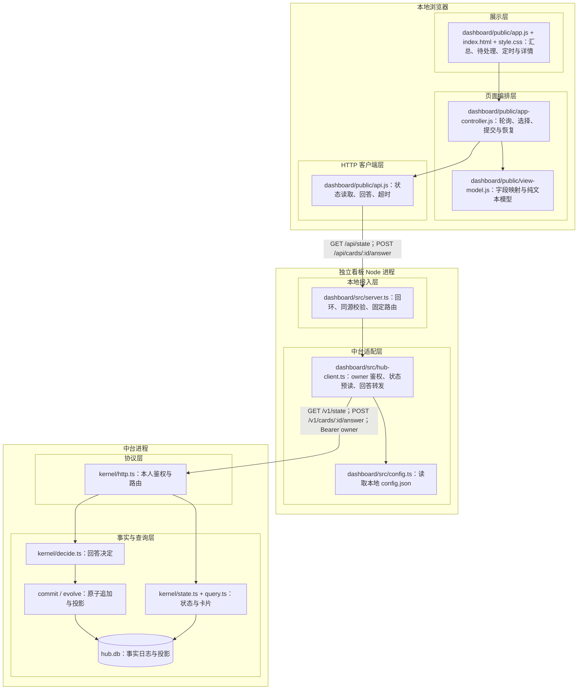
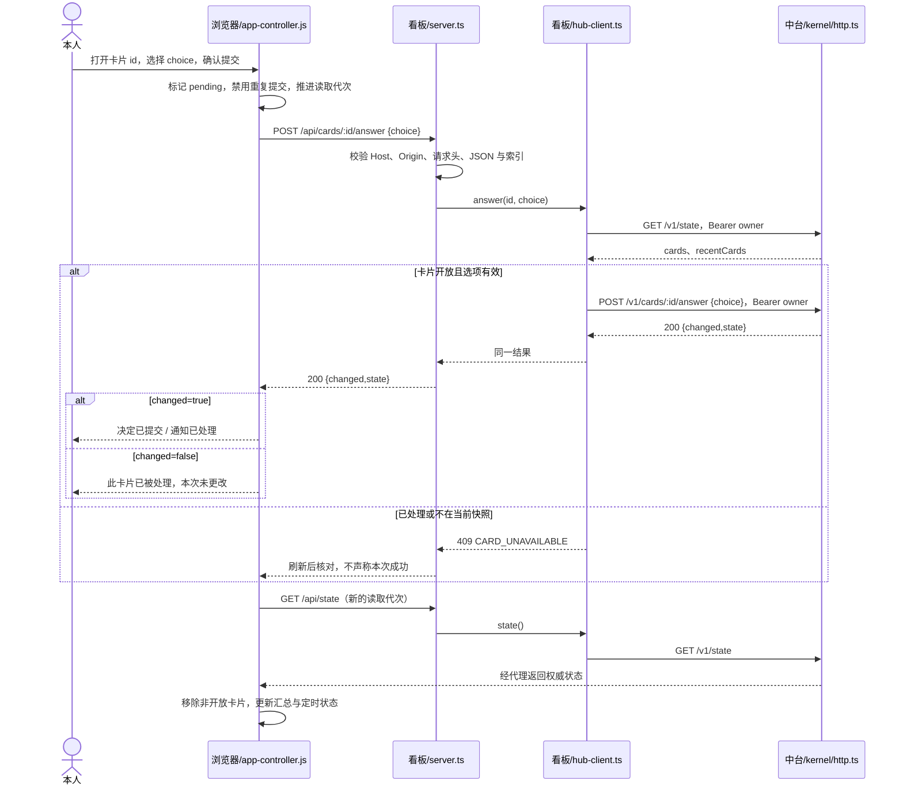
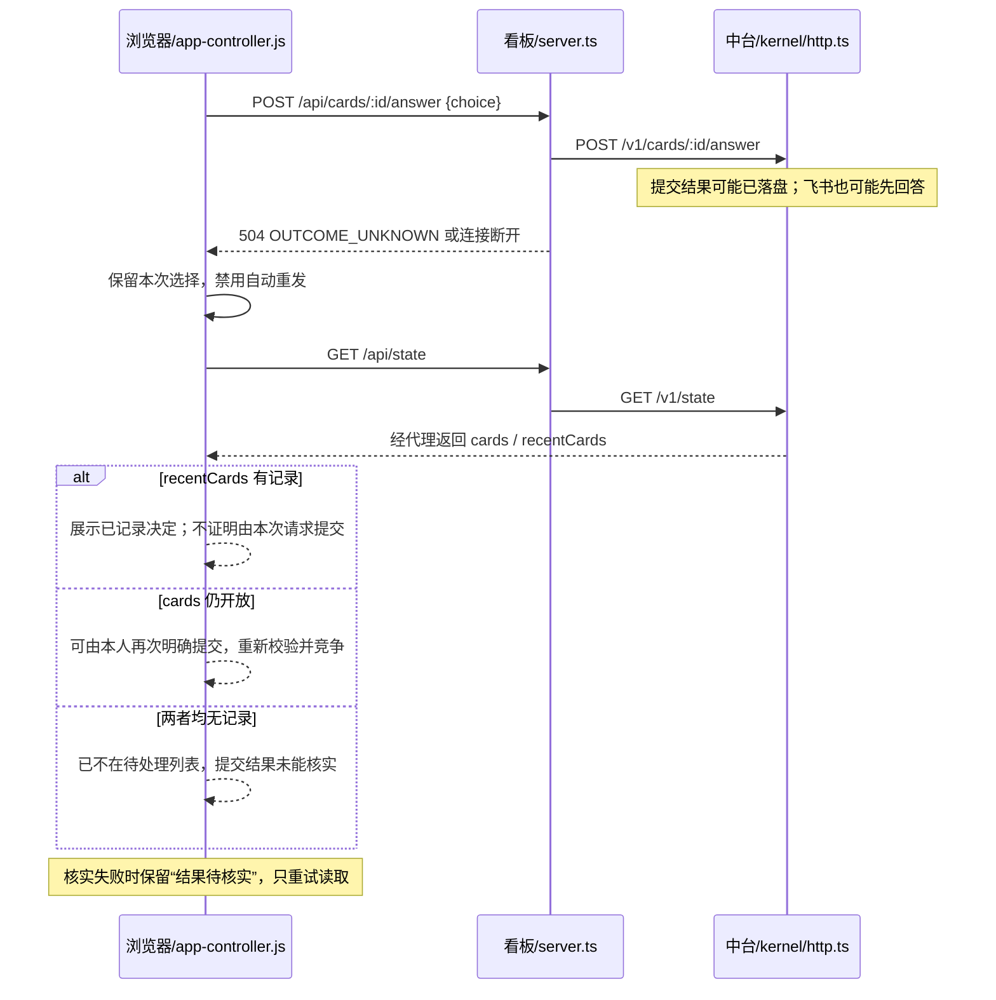

# 本地任务看板与审批技术方案

本方案定版范围：将已有看板迁入本仓库，保留独立本地进程；页面只展示汇总、待我处理与定时任务；问题卡片只能选择原有选项，通知提供“已处理”。这是设计定版，不表示实现或验收完成。

用户已确认同仓库独立进程、精简展示及上述回答方式。此方案替代此前只读看板方案的目标范围；已有实现是迁入基线，不代表本方案已经交付。[原交付计划](../plans/local_dashboard.md)仅记录旧只读版本的交付事实，本次不修改其执行状态，也不自动启动开发。

## 需求与验收

### 我用这个看板做什么

我希望打开一个页面，就知道现在有哪些事情等我拍板，以及定时任务接下来什么时候执行。需要我决定时，我能在这里看清内容、选好处理方式并提交，不必再切到飞书或命令行完成同一次审批。已经做完的事情不再占据列表，只用汇总数字告诉我今天完成了多少。

### 从打开到处理完，我应该获得什么体验

| 需求 | 我的使用场景 | 我能看到或做到的结果 |
|---|---|---|
| R1 打开就知道有没有事情等我 | 我打开看板，想先看看是否需要我做什么 | 首页能直接看到“待我处理”，每件事有标题和时间，能知道在问什么；没有待处理事项时明确告诉我“暂时没有需要你处理的事项” |
| R2 不被已经完成的事情打扰 | 我只关心现在要处理什么，也想知道今天做了多少 | 首页只保留汇总、待我处理、定时任务三个区域；已经完成的事情不再列出来；汇总告诉我有多少待处理、多少正在运行、今天完成了多少轮执行 |
| R3 看清楚再决定 | 我看到一件待处理事项，想知道具体内容再选 | 点开即可阅读完整问题或报告、查看相关链接和所有可选处理方式；长报告可以展开；只阅读或关闭详情不会作出任何决定 |
| R4 在看板上完成审批 | 我已经看完内容，想按其中一个选项处理 | 我可以选择原有选项，例如“发布 3 条评论”或“不发布”，再明确提交；系统不会替我选中推荐项，也不提供自由输入；提交期间能看到正在提交，不能连续重复提交 |
| R5 知道自己的决定有没有提交成功 | 我提交了审批，想知道是否还需要再操作 | 收到确定成功的结果后，页面明确告诉我“决定已提交”，这件事从待处理列表消失，待处理数量更新；提示不把提交成功说成后续业务已经完成 |
| R6 处理完通知就把它收起来 | 有一条通知需要我确认处理，但不需要选择方案 | 我可以阅读内容后点击“已处理”；成功后看到处理成功提示，通知从待处理列表消失，不再要求我审批一次 |
| R7 看懂定时任务的安排 | 我想知道有哪些定时任务、下次什么时候执行 | 每项显示名称、执行周期和下次计划执行的日期时间；能分清正在执行、排队、执行结果不确定或等待下次计划；在其他系统执行、这里无法判断进度的任务明确说明状态未知 |
| R8 在飞书处理过，就不用再处理一遍 | 我已在飞书或另一个看板页面作出决定，随后回到这个页面 | 页面刷新后不再把它列为待处理；如果我恰好又点了提交，会收到“此卡片已被处理，本次未更改”的提示，不会覆盖之前的决定 |
| R9 网络不好时也知道现在是什么情况 | 我阅读或提交时断网、加载失败或长时间没有响应 | 原内容和未提交的选择不会因普通刷新失败而丢失；页面说明数据最后更新时间。提交结果不确定时明确提示“结果待核实”，不会偷偷再次审批，也不会直接告诉我成功或失败；恢复连接后重新核对 |
| R10 使用看板不需要另装一个项目 | 我已经安装工作流，想打开看板，或者用完后关掉它 | 从工作流提供的看板入口即可打开本地页面，无需另找、另装看板项目；退出看板后，工作流里的任务仍可继续运行，飞书和命令行仍可照常使用 |

“今日完成轮次”按工作流设置的时区统计：同一件事如果分几轮执行，会按实际完成的轮数计数；取消、没有可做的轮次不算完成。页面明确写“轮次”，避免让人误以为是完成事项数。

### 一个完整的使用例子

我打开看板，看到“待我处理 2 项”：一份等待确认发布的审查报告和一条通知。我打开报告，展开完整内容，选择“发布 3 条评论”，再点击确认。看板提示“决定已提交”，待处理数量变成 1；这时只表示我的决定已收到，不能显示成“评论已经发布”。接着我打开通知，点击“已处理”，待处理数量变成 0，页面显示“暂时没有需要你处理的事项”。下面仍能看到各项定时任务的下次计划时间，已经处理的两项不再变成一份历史列表留在首页。

### 这次使用上的边界

- 只能选择已有选项，或把通知标为“已处理”；不能输入其他想法、修改报告或一次批准多项。遇到没有选项、只能文字回答的旧问题，仍可看内容，但页面会提示从原通道或命令行回答。
- 定时任务在这里供查看，不能新增、修改时间、暂停或立即运行；看板也不提供停止、重试正在执行任务的按钮。
- 已完成内容只显示汇总，不提供完成列表、历史翻页或执行时间线；审批后的实际业务结果继续按既有任务流程反馈。
- 本次用于本人在这台电脑上打开，不提供手机远程访问或多人登录。页面会自动刷新，也可以手动刷新；刷新不会清掉我正在选择的选项。重新加载整个页面后需要重新选择，但已经提交的决定不会丢失。

上述描述对应本次已确定范围；技术实现与故障处理见后文，具体检查入口见“验收矩阵”。

## 业界方案调研与选型依据

查证日期：2026-11-13。调研覆盖任务监督面板、专门的人工介入入口、持久化人工决定协议及部署审批；核对官方文档和源码，没有运行竞品或声称其已通过本项目验收。

| 候选与复用方式 | 能力、适配成本及边界 | 成熟度与证据 | 来源及基线 | 取舍 |
|---|---|---|---|---|
| dsh-superagent，借鉴信息组织 | 先看需要人的事项，再看健康和历史；详情含授权依据。源码提供重试、停止、暂停；问题回答跳原通道。搬代码需适配 React、Harness、Ticket/Assignment 模型 | 有条件可用作设计参考；官方明确为研究原型，不能当作生产验证 | 远端 HEAD 与本地均为 `8c32a9dc5d72c033816c6a8110b37f40cf94fba4`，包 0.1.0；[Panel](https://github.com/deepseek-ai/dsh-superagent-prototype/blob/8c32a9dc5d72c033816c6a8110b37f40cf94fba4/docs/005-panel.md)、[TicketPage](https://github.com/deepseek-ai/dsh-superagent-prototype/blob/8c32a9dc5d72c033816c6a8110b37f40cf94fba4/src/client/ticket.tsx)、[项目定位](https://github.com/deepseek-ai/dsh-superagent-prototype#readme) | 采用待处理优先、动作紧邻资料、折叠次要信息；不引入配置中心和 Ticket 模型 |
| LangChain Agent Inbox，评估直接复用 | 展示动作与参数；按配置支持接受、编辑、回复、忽略。依赖 LangGraph 部署及 HumanInterrupt/HumanResponse；连接信息在浏览器存储 | 有公开源码和协议；未验证接入本项目，不声称生产成熟 | [官方 README](https://github.com/langchain-ai/agent-inbox)，当日 main 文档 | 不移植客户端：需另一套协议与框架适配，且凭据存储边界不同；借鉴清楚展示对象与允许操作 |
| LangChain HITL，借鉴决定语义 | approve/edit/reject/respond 分开，检查点持久化后恢复；文字回复不能替代拒绝副作用操作 | 官方当前支持；依赖其执行器与持久化栈，不能直接作为本项目恢复机制 | [官方文档](https://docs.langchain.com/oss/javascript/langchain/human-in-the-loop)，当日在线文档 | 采用决定与执行分离；不引入执行图，不把 Agent Inbox 的响应枚举当作同一协议 |
| GitHub 部署审批，跨领域借鉴 | 先选目标再批准或拒绝，批准后其他保护规则仍须满足 | 官方产品机制；适用于明确对象且执行前仍有校验的流程 | [官方文档](https://docs.github.com/en/actions/how-tos/deploy/configure-and-manage-deployments/review-deployments) | 借鉴动作文案与批准/执行完成分离；不迁入部署领域状态机 |
| 本项目现有卡片协议，直接复用 | 内容不可变、第一次回答生效、事实日志持久化、回答后接续；Node 服务和原生网页现成 | 已有源码及 HTTP、卡片、GitLab 行为测试；本次新页面仍须集成验收 | `kernel/decide.ts`、`kernel/http.ts`、`kernel/query.ts`、`tests/cards.test.ts`、`tests/http.test.ts` | 采用；无需另一套审批服务或状态所有者 |
| OWASP 同源写入防护，机制复用 | 校验 Origin、自定义请求头、限制内容类型与 CORS；不能替代本机用户边界 | 官方指导，适配本地带权限代理；须通过伪造请求测试验证实现 | [CSRF Prevention](https://cheatsheetseries.owasp.org/cheatsheets/Cross-Site_Request_Forgery_Prevention_Cheat_Sheet.html) | 采用固定同源写入口，不仅依赖回环监听 |

采用现有原生网页与 Node 24；必要自研仅为卡片详情、受限写代理和浏览器提交状态。引入竞品整套客户端会增加领域模型映射、运行时依赖和凭据适配责任。已有 HTTP 协议与平台能力足以支撑选型，没有需要先通过实验才能成立的架构假设；超时后历史查询有限的限制按下文准确表达，不假设额外接口存在。

## 目标架构与影响范围

选择 A：同仓库、独立看板进程。中台独占业务事实与投影；看板仅持有配置和请求期间的内存，浏览器仅持有页面状态。下图实线表示运行时调用或读取；同仓库不代表同进程。



`dashboard/` 路径均为迁入后的设计位置；原实现位于 `/Users/shenyue/project/agent-autoloop-dashboard`。中台模块已存在，仍遵守判断与提交在同一事务内的边界。

| 维度 | A 同仓库独立进程（已选） | B 并入宿主进程（未选） |
|---|---|---|
| 需求覆盖 | 满足本地展示与审批 | 同样满足 |
| 收益 | 复用既有运行方式，界面故障与调度隔离 | 少一个进程与代理跳转 |
| 改动 | 搬迁、安装/CLI/CI 接线、审批入口 | 还需改宿主路由、监听及浏览器鉴权边界 |
| 验证 | 迁入安装、安全代理、审批闭环 | 额外验证中台监听不会暴露界面权限 |

### 页面数据映射与实现约束

- 汇总：待我处理 `cards.length`、运行中 `totals.running`、今日完成 `totals.doneToday`。今日按中台 `timezone` 的当天零点统计，只统计 `done` 轮次，不是唯一事项数；不含 `nothing`、取消和未完成轮次。标签写“今日完成轮次”。这是展示口径，不新增统计投影。
- 待我处理：仅取 `cards` 中的 `open` 卡片，按接口顺序显示。摘要含标题、规则名（若有）、创建时间和正文首段的纯文本预览（最多 300 字，超出加省略号，全文仍在详情）；MR 审查卡片由 GitLab 插件在首段提供仓库路径、MR 编号与 MR 标题，不由看板猜测归属或主动查询 GitLab；缺失规则显示“系统通知”或“未关联规则”，不推断所属任务。点击打开同页详情，关闭不提交。正文完整可读，长报告可展开；不新增 Markdown 执行能力。
- 问题详情：展示原选项，索引从 0 开始。`recommend` 只标记“建议”，不预选；用户选中后点击“确认：〈选项原文〉”。无选项的旧问题仍可阅读，提示“此问题需要文字回答，请使用原通道或命令行”，不伪造审批选项。
- 通知详情：唯一操作“已处理”，直接提交，不附加确认弹窗。问题和通知的关闭详情操作均不改变业务状态。
- 定时任务：从 `lines` 取 `every` 或 `next` 非 null 的规则，另展示 `elsewhere`，以“中台/外部 + id”区分。每项显示周期、下次计划日期时间及中台时区。中台任务显示各自 `totals.running`、`queued`、`retrying`、`unknown`（重派为排队子集，不相加）；unknown 大于 0 时必须显示“执行结果不确定”，不能据此推断进程已经停止。只有 running、queued、unknown 均为 0 时显示“等待下次计划”。`next` 是计划时间，不承诺该时刻一定执行。外部任务不推断运行状态。
- 已处理卡片不形成历史区。当前操作的结果提示可留在详情中直到关闭；后台读取 `recentCards` 只用于核实当前请求，不渲染为列表。
- 保留立即加载、可见页面 10 秒轮询、手动刷新、后台暂停和恢复可见立即刷新。页面失败保留旧数据并标示最后成功时间，不能把旧数据伪装成实时数据。


### 迁入、安装与维护约定

- 迁入基线：外部看板提交 `3e4671f5f08f3919f87a42821037c6ac9d10cfef`；中台提交 `04f2a972855ebfc6596b44f4c555c290061c101c`。实施前核对两个工作区新增改动，不覆盖其他任务内容。
- 原 `src/`、`public/` 移入 `dashboard/`；测试合并到根 `tests/dashboard-*.test.ts`，使用项目现有 Node 测试入口。原历史分页和 why 页面模块不作为新入口保留；可复用的轮询、安全渲染及集成验证保留，并按新范围调整行为规格。旧交付记录保留在既有记录位置，不能改写为新功能完成证据。
- 不带入嵌套 `.git`、独立锁文件、node_modules 或第二份运行配置；使用根 package.json。服务端迁为 TypeScript 以纳入现有 typecheck；浏览器保持原生 JS，增加明确的 checkJs 检查配置与格式覆盖，不引入构建或运行时包。
- 拟新增 `cli/dashboard.ts`，由 `cli/main.ts` 接入 `agent-autoloop dashboard`：前台运行直到退出，仅启动看板，不启动/停止中台，不自动打开浏览器。默认 `127.0.0.1:3352`，保留 `PORT` 环境覆盖，非法端口启动失败；测试可通过工厂传入端口 0。
- 保留 `AGENT_AUTOLOOP_HOME` 配置路径，缺省 `~/.agent-autoloop`。上游 url 仅允许本机回环 HTTP/HTTPS，无 userinfo/query/fragment，owner 非空；配置错误时不监听。中台离线但配置合法时看板可启动，页面显示连接失败。
- `cli/local-install.ts` 的运行文件白名单必须纳入 dashboard；核对 install.sh 的实际安装路径。统一安装与升级，无数据迁移。升级操作约定为先退出看板，再运行安装/更新命令，随后重新启动看板并重新加载页面；INSTALL、CLI 帮助和更新提示必须明确此顺序，不声称更新命令会自动重启看板。为避免误操作时混用，进程启动时固定读取静态白名单资源到内存，同一进程始终提供同一版本资源；每次启动生成进程标识，经 GET /api/state 的 X-Dashboard-Instance 响应头传给浏览器，写请求必须带相同标识，服务端不匹配时在任何上游调用前返回 409 PAGE_RELOAD_REQUIRED。旧页面在新进程出现后禁用提交、提示重新加载，不自动重试写入。首次成功加载的标识不能被后续轮询静默替换；标识只用于版本一致性，不是鉴权凭据。退出关闭看板 HTTP 服务及未完成上游请求；已发出的审批不能因退出被视为未提交。
- 正式迁入后当前仓库为维护来源。旧目录不再作为安装或运行依赖；本次设计不删除旧目录或未提交文件。实施交付时核对迁入归属并明确旧目录停用状态，避免两处继续维护。
- 同步调整 AGENTS.md、协议、架构图、两份 README、INSTALL、SKILL、SECURITY 和相关示例的“界面不进仓库/只读/独立仓库”描述：允许同仓库的外部客户端，kernel 仍不包含 UI 或导入 dashboard。`host/http.ts` 保持原职责。
- `scripts/ci-scope.sh` 将 dashboard 代码归 normal，新增类型/格式配置按现有未知配置规则走 full；全部新测试接入根 npm test 与 test:quick，安装冒烟覆盖看板资源。协议/schema.sql 不新增字段或迁移。

## 交互过程

### 本人阅读并提交选项

打开待处理卡片，明确选择后提交；预读用于校验请求，最终竞争结果仍由中台事务决定。



### 提交超时与其他入口竞争

写请求可能已经提交，页面只读核实；任何旧的轮询响应都不能重新激活该卡片。



## 交互协议

### 公共本地边界

- 仅回环监听；Host hostname 只接受实际支持的回环主机名，端口须为本次监听端口，拒绝额外 userinfo/path 等畸形 Host。
- 所有写请求必须有与当前合法 Host 构成的页面 origin 精确相同的 `Origin`（scheme、host、port），拒绝缺省或 `null`；要求 `X-Dashboard-Action: answer` 和 `Content-Type: application/json`（允许 charset）。不返回 CORS 许可；拒绝跨站预检。`Sec-Fetch-Site` 若存在只接受 same-origin。
- owner 只由本地配置注入上游，不接受浏览器 Authorization/by/ref/channel/text；密钥不进入静态页面、浏览器存储、URL、日志或错误响应。此边界信任同一操作系统用户，不提供本机恶意进程防护或多人权限模型。
- 页面禁用嵌入：`frame-ancestors 'none'`、`X-Frame-Options: DENY`；CSP 限制脚本、连接及样式为自身，`object-src 'none'; base-uri 'none'; form-action 'self'`；外链仅 HTTP/HTTPS，`noopener noreferrer`。不使用动态 innerHTML。
- 静态资源固定白名单，GET/HEAD；API 只开放下述 GET 和 POST，不提供任意上游 URL。静态页面与 API `Cache-Control: no-store`。上游禁止跟随重定向，避免携带 owner 到非预期目标。
- 上游每次请求保持既有 5 秒超时并覆盖响应体读取；浏览器写请求使用 15 秒上限以覆盖预读及写入。此为实现参数，不是性能验收目标。请求体上限 1 MiB，与中台现有限制一致，超过即拒绝并停止累积。

### 功能：状态读取

浏览器初次打开、轮询、手动刷新与提交后核实时读取状态。

| 项目 | 定义 |
|---|---|
| 发送方与接收方 | dashboard/public/api.js → server.ts → hub-client.ts → kernel/http.ts |
| 入口 | `GET /api/state` → `GET /v1/state` |
| 请求 | path/query/body 均无参数；浏览器无需 Authorization；不接受 before 或其他 query |
| 成功 | 200 JSON，透传现有状态；页面仅使用下列字段，忽略新增字段 |

| 字段 | 类型与必填 | 含义与约束 |
|---|---|---|
| now / timezone | string，必填 | 状态 ISO 时间与中台时区 |
| totals.running / totals.doneToday | 非负整数，必填 | 运行中轮次与中台时区今日 done 轮次 |
| cards | Card[]，必填 | 所有开放卡片；权威待处理集合 |
| recentCards | Card[]，必填 | 最近 20 张非开放卡片，仅辅助核实；缺失记录不等于本次失败 |
| lines | object[]，必填 | 每项 id/name 为字符串；every/next 为字符串或 null；totals.running/queued/retrying/unknown 为非负整数；按页面定义过滤 |
| elsewhere | object[]，必填 | id/name/every/next/where 为字符串；无可信执行状态字段 |

Card 使用现有 `kernel/query.ts:cardView` 与 [协议的通道卡片/本人接口](../protocol.md#本人看全局回答结案停止)：`id` 为正安全整数，`version` 为整数，`kind` 为 ask/notice，`state` 为 open/decided/done/closed，`title/text` 为字符串，`options` 为字符串数组，`recommend/choice` 为索引或 null，`answer/by/result/rule` 为字符串或 null，`createdAt` 为 ISO 时间，`decidedAt/closedAt` 为 ISO 时间或 null，`ref/link` 为字符串或 null。问题内容创建后不变；通知开放时 options 为 `["已处理"]`。未知 kind/state 只读并提示不支持，不提交。

示例：`GET /api/state`，成功返回完整现有 `/v1/state` 对象，权威定义为 `kernel/state.ts` 与 `kernel/query.ts:cardView`；本方案不复制其余未使用字段。格式不合约或关键字段缺失按读取失败处理，不伪造空列表。代理返回前校验本表所需字段：cards/recentCards/lines/elsewhere 必须为数组，计数字段为非负整数，卡片 id/options 等字段满足 Card 定义；缺失数组不能默认成 []，缺失计数不能默认成 0。未知 kind/state 允许只读展示，但不允许提交；其他新增字段忽略。校验失败返回 502 UPSTREAM_UNAVAILABLE，页面保留上次有效数据并提示读取失败；首次加载失败不显示“暂无待处理”。

读取失败使用 `{error:string, code:string}`，字段均必填且不含秘密；400 INVALID_REQUEST（非法 query），403 LOCAL_ACCESS_DENIED，401 UPSTREAM_AUTH_FAILED，502 UPSTREAM_UNAVAILABLE（含异常状态、格式或重定向），504 UPSTREAM_TIMEOUT。浏览器保留数据，标明错误；只按正常轮询或用户刷新重读。

### 功能：提交原有选项或处理通知

本人从详情明确提交一个选项；通知发送索引 0。

| 项目 | 定义 |
|---|---|
| 发送方与接收方 | dashboard/public/api.js → server.ts → hub-client.ts → kernel/http.ts |
| 本地入口 | `POST /api/cards/:id/answer` |
| 上游入口 | `POST /v1/cards/:id/answer`，服务端添加 Bearer owner |
| 前提 | 通过公共写入校验；本地预读显示开放，选项合法；最终是否接受仍由内核裁决 |
| 成功 | 200 JSON `{changed:boolean,state:string}`，两个字段必填，直接保留中台值 |

| 位置／字段 | 类型 | 必填 | 约束 |
|---|---|---|---|
| path id | 十进制正安全整数 | 是 | 不接受 0、负数、小数、溢出值或额外路径 |
| Header Origin | string | 是 | 精确同源，见公共边界 |
| Header X-Dashboard-Action | string | 是 | 仅 answer |
| Header Content-Type | string | 是 | application/json，允许 charset |
| Header X-Dashboard-Instance | string | 是 | 首次状态读取返回的本进程标识；缺失或不匹配返回 409 PAGE_RELOAD_REQUIRED，不转发 |
| query | 无 | — | 拒绝任何 query |
| body choice | number | 是 | 非负安全整数；ask 必须小于原 options.length；notice 仅 0 |
| body 其他字段 | 不允许 | — | 顶层必须普通 JSON 对象，不接受数组/null、text/by/ref 等 |

`changed=true,state=decided` 表示问题决定已记下；`changed=true,state=closed` 表示通知已处理。`changed=false` 表示没有应用本次选择，state 为中台当时状态，不能显示本次批准成功。

服务端在发送写请求前通过 state 验证卡片类型及索引。若 recentCards 含目标或目标未出现在全部 cards 中，返回 409 CARD_UNAVAILABLE，不猜测是不存在还是较早已处理。开放但未知类型、无选项或越界返回 400 INVALID_CHOICE。预读与写入之间允许竞争，中台仍原子决定第一次有效输入，无需本地锁或二次业务状态库。

所有失败响应字段：`error`（必填 string，人可读中文）、`code`（必填 string，下表枚举），无其他秘密或原始异常。未知上游错误不原样泄露响应体。

| HTTP / code | 触发与结果确定性 | 页面处理 |
|---|---|---|
| 400 INVALID_REQUEST / INVALID_CHOICE | 请求格式错误，或中台明确拒绝选项；未应用本次决定 | 保留内容，显示错误并刷新 |
| 401 UPSTREAM_AUTH_FAILED | 中台明确拒绝本人密钥 | 停止提交，提示检查本地配置 |
| 403 LOCAL_ACCESS_DENIED | 本地 Host/Origin/请求头校验失败 | 不转发，提示从本地正确地址打开 |
| 404 NOT_FOUND | 本地路由或中台卡片不存在 | 关闭提交入口并刷新 |
| 405 METHOD_NOT_ALLOWED | 不允许的方法；附 Allow | 不重试写入 |
| 409 PAGE_RELOAD_REQUIRED | 进程已更换或请求缺失进程标识，未发送写入 | 禁用审批，要求重新加载页面，不自动重试 |
| 409 CARD_UNAVAILABLE | 预读已无开放卡片，或中台冲突 | 只读核实，不称本次成功 |
| 413 BODY_TOO_LARGE / 415 UNSUPPORTED_MEDIA_TYPE | 本地请求体过大或类型不符 | 不转发，不自动重试 |
| 502 UPSTREAM_UNAVAILABLE / 504 UPSTREAM_TIMEOUT | 预读阶段失败，尚未发送写入 | 提示未发送，允许恢复后重新操作 |
| 502 或 504 OUTCOME_UNKNOWN | 写入发出后网络/超时/非合约响应/上游 5xx 等无法证明结果 | 提示结果待核实，自动只读刷新；禁止自动重发 |

浏览器自身超时或丢失连接时同样按 OUTCOME_UNKNOWN 处理，不能因没有收到服务端标识而判断未提交。

```http
POST /api/cards/56/answer HTTP/1.1
Host: 127.0.0.1:3352
Origin: http://127.0.0.1:3352
Content-Type: application/json
X-Dashboard-Action: answer
X-Dashboard-Instance: example-process-id

{"choice":0}
```

```json
{"changed":true,"state":"decided"}
```

通知使用同一请求体，成功响应为 `{"changed":true,"state":"closed"}`。典型失败为 HTTP 409：

```json
{"error":"此卡片已不在待处理列表，请刷新核对","code":"CARD_UNAVAILABLE"}
```

### 页面提交与恢复规则

| 场景 | 行为与裁决 |
|---|---|
| 尚未提交 | 按卡片 id 在内存保存选择；轮询不得重置选择；移除或变为非 open 时禁用提交 |
| 提交中 | 同一卡片仅一个浏览器请求；按钮禁用；不乐观显示成功；关闭详情不取消或撤销审批 |
| 读写交错 | 提交开始和结束均推进读取代次，丢弃较旧读响应；提交后强制发起新读取，不能复用提交前的 pending 读取 |
| 确定成功但刷新失败 | 保留“决定已提交/已处理”和本页已处理标记，避免旧缓存重新开放；其余旧数据标为过期 |
| changed=false 或竞争 | 展示“此卡片已被处理，本次未更改”；recentCards 可展示实际选择、by、时间、result，不把选择相同当作本次成功证明 |
| 超时后仍 open | 说明上次结果未确认，用户可再次明确提交同一卡片；不自动重试，后到请求仍由内核首次生效规则约束 |
| 超时后非 open | 展示中台记录的决定；若 recentCards 无记录，显示“已不在待处理列表，提交结果未能核实”，不允许再次提交 |
| 页面重载或进程重启 | 丢弃本地临时选择，从中台恢复；不恢复写请求，不需要浏览器持久化或迁移 |
| GitLab 发布 | 精确提交原选项索引且不带 text，保持 `plugins/gitlab/answer.ts` 的授权语义；发布仍核对 MR head、身份与清单；看板不直接调用发布接口 |

## 对外协议变更

比较基线为上述两个具体提交；这是新看板版本，浏览器与本地服务整体更新，不维护旧页面与新代理的混用兼容层。

| 接口／行为 | 类型 | 变更前 | 变更后 | 适配责任 |
|---|---|---|---|---|
| `agent-autoloop dashboard` | 新增 | 不存在，独立仓库 npm start | 当前安装包启动独立进程 | CLI、安装、帮助与文档接线 |
| 本地 POST answer | 新增 | 不存在，API 只读 | 固定选项写入，含本地安全与不确定结果契约 | 页面与代理同步更新 |
| 本地 GET state query | 修改 | 支持 before 历史分页 | 不接受 query | 页面删除分页请求 |
| 本地 GET runs/:id/why | 删除 | 看板时间线代理 | 本次看板无此入口，原 CLI why 可用 | 页面和静态模块移除旧入口 |
| 本地进程标识 | 新增 | 无此字段 | 状态响应头 X-Dashboard-Instance、写请求同名头及 PAGE_RELOAD_REQUIRED | 浏览器首次绑定，进程变化需重载 |
| 本地错误响应 | 修改 | error 文本、部分原样透传 | error + code，按阶段标识是否已发出写入 | api.js 按 code 处理 |
| 首页与历史 | 修改 | 多种状态列表及完成历史 | 汇总、待处理、定时任务 | 页面模型、测试同步更新 |
| 中台 `/v1/*`、卡片及事实日志 | 无变更 | 当前协议 | 保持原定义 | CLI、通道与 Worker 无需升级适配 |

先完成同仓库资源与 CLI/安装接线，再整体交付新页面与服务。旧看板进程需要退出，避免默认端口占用；部署回退可恢复旧只读客户端，中台已记录的决定不会撤销，也不需要数据迁移。

## 验收矩阵

以下为计划验证，尚未执行。所有标注“拟新增”的测试入口在实现时接入根测试命令；不拿旧版 61 项测试通过作为新版验收结论。

| 功能／场景 | 级别 | 执行入口 | 通过标准与证据 |
|---|---|---|---|
| 同仓库启动、安装与退出 | L1 | 拟新增 `tests/dashboard-install.test.ts`，扩展 `tests/local-install.test.ts` 与 `scripts/install-smoke.sh` | 临时 HOME 安装后无需外部仓库可打开页面；退出看板中台仍响应；非法配置不监听；记录测试名与退出码 |
| 精简页面、汇总与时区 | L0 | 拟新增 `tests/dashboard-view-model.test.ts` | 待处理数与列表一致，为零时明确显示暂无待处理事项；今日完成采用上游值且标为轮次；无完成列表和历史入口；跨日期显示无歧义 |
| 定时任务与外部状态 | L0 | 同上 | 仅定时规则和 elsewhere 出现；重派不重复计数；unknown>0 且其他计数为 0 时显示执行结果不确定，不能显示等待下次计划；外部不伪造运行状态 |
| 详情、选择与旧问题无选项 | L1 | 拟新增 `tests/dashboard-app.test.ts` | 全文可阅读；推荐不预选；无文字输入；没有选择不能提交；无选项问题保留只读提示 |
| 原有选项审批接续 | L1 | 拟新增 `tests/dashboard-hub-integration.test.ts`，临时真实中台 | 经看板发送决定后 card=decided、日志仅一条有效回答，Worker 得到正确 choice 且 text=null；页面移除卡片 |
| 通知已处理 | L1 | 同上 | 通知 closed，未新增问题续办事件，页面移除通知 |
| 飞书/页面竞争与重复提交 | L1 | 同上，复用 `tests/http.test.ts`、`tests/cards.test.ts` 场景 | 两种先后顺序只记录一个决定，后到 changed=false；通知/回答与结案竞争不覆盖已完成决定 |
| 超时、断线与已处理记录超出 20 张 | L1 | 拟新增 `tests/dashboard-server.test.ts`、`tests/dashboard-app.test.ts` | 写入已成功但响应丢失时不自动重发；可读到记录则显示事实，否则准确提示未核实；无错误成功提示 |
| 响应头已返回但正文挂起，以及退出清理 | L1 | 拟新增服务与安装集成测试，使用假上游 | 分别使状态预读、回答响应在返回头后挂起，完整读取仍在配置超时内中止；预读为 UPSTREAM_TIMEOUT 且无写入，写入为 OUTCOME_UNKNOWN；退出有挂起请求的看板进程后上游观察到断开且进程退出、中台继续响应 |
| 缺失或畸形的成功响应 | L1 | 拟新增服务与页面测试 | 上游返回 200 空对象、缺 cards、非数组 cards、缺计数或非法选项类型时拒绝该状态；已有页面保留数据并显示错误，首次加载显示失败而非暂无待处理 |
| 升级期间进程与页面版本一致 | L1 | 拟新增安装与服务测试 | 运行中替换磁盘静态资源后旧进程仍提供原资源；重启后旧页面的写请求以 PAGE_RELOAD_REQUIRED 拒绝且上游无写入；刷新页面后使用新标识可以审批；验证退出、更新、重启流程 |
| 轮询、选择保留与迟到读响应 | L1 | 拟新增 `tests/dashboard-polling.test.ts` | 后台不轮询；写入前的读不能重新开放已处理卡片；提交后确实启动新读取；错误保留旧数据及时间 |
| 同源写入与密钥隔离 | L1 | 拟新增 `tests/dashboard-server.test.ts` | 错误/缺失 Origin、跨站请求、未知字段、错误密钥、越界、任意路径全部被拒绝；检查浏览器可见响应无 owner；上游不随重定向 |
| 恶意正文、链接与嵌入 | L1 | 拟新增页面与服务测试 | 动态文本无脚本执行；非 HTTP 链接不可点击；响应具备 CSP 与防嵌入头 |
| 原有 GitLab 发布兼容 | L1 | `tests/gitlab-answer.test.ts`、`tests/gitlab-integration.test.ts` 与新看板集成 | 原选项可被发布授权识别；拒绝不发布；head/清单检查仍生效，不发送真实消息 |
| 工程与内核边界 | L0/L1 | `npm test`、`npm run typecheck`、`npm run format:check`、`tests/purity.test.ts` | 新测试全部纳入且通过；kernel 不导入 dashboard；安装/CI 路径完整；保存命令退出码 |

本次迁入涉及 package/检查配置，最终跑完整检查；后续只改 dashboard 且无内核/协议/模拟修改时按仓库规则走 test:quick。没有日志结构、到期表或内核并发算法改动，不额外扩写模拟或变异框架；若实施改变这些范围，重新评估 nightly。全部写测试使用临时 HOME、随机端口、假通道与假桌面通知，不连接在线飞书监听，不写真实业务数据。

### 人工验收项

| 场景 | 无法完全脚本化的部分 | 人工动作 | 判定依据 |
|---|---|---|---|
| 阅读资料与明确提交 | 长报告可读性、选项及结果提示是否清楚属主观体验；操作正确性可脚本化 | 在临时中台打开问题，展开报告，选项提交，再处理一张通知 | 截图与网络/中台事实核对：无默认批准、无自由文字、提交结果准确、卡片移除、首页无完成列表；可读性由本人判断 |

设计验证限制：已核对源码、现有接口、安装白名单及竞品资料；未运行新版测试或迁移代码。当前环境未发现 mmdc，Mermaid 仅做静态核对，未渲染。实施必须以本矩阵的新证据完成验收。

审查记录：Kimi CLI 2.4.1 首轮发现 4 项中风险、无高风险；已补充不确定执行状态、升级版本一致性、响应正文挂起及退出验收、畸形成功响应校验与验收。定向复审确认四项关闭，未发现剩余中高风险。此结论仅针对方案静态审查，不表示实现或测试通过。
