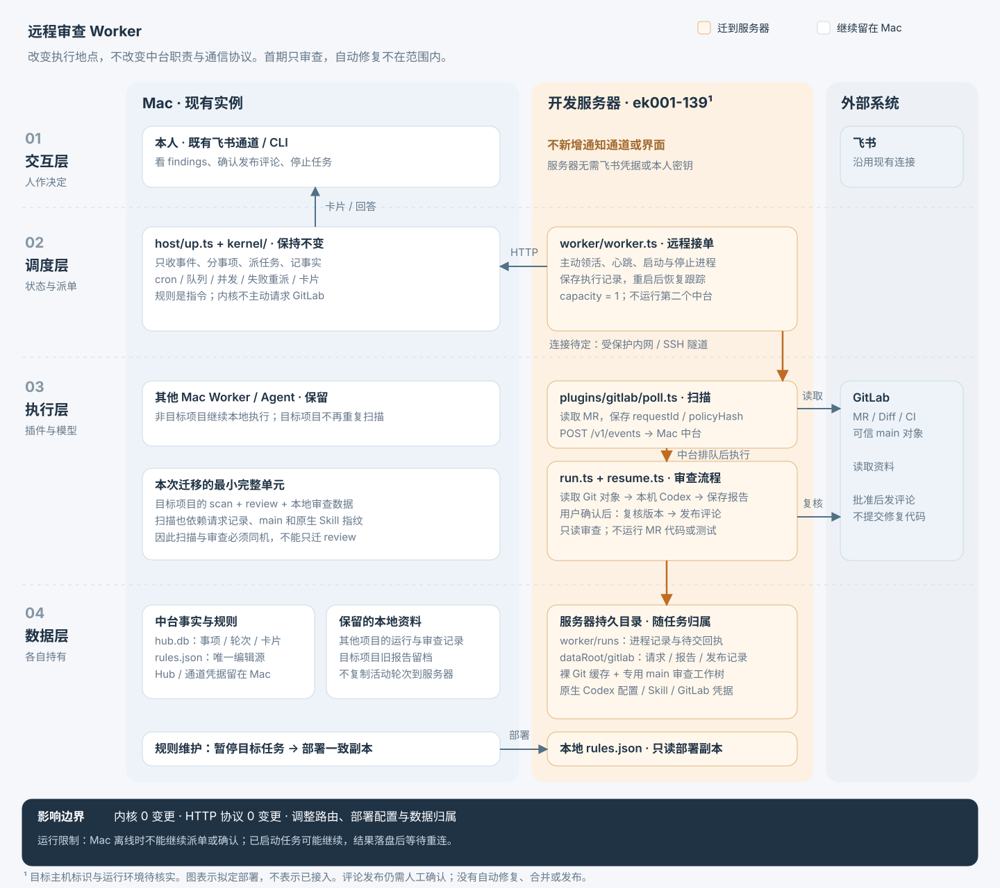
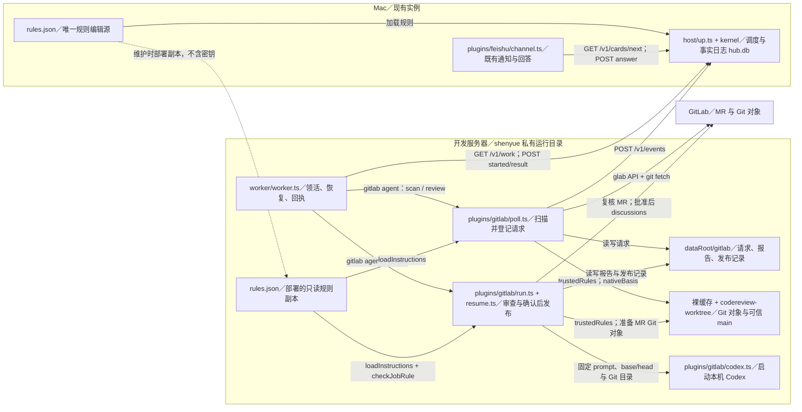
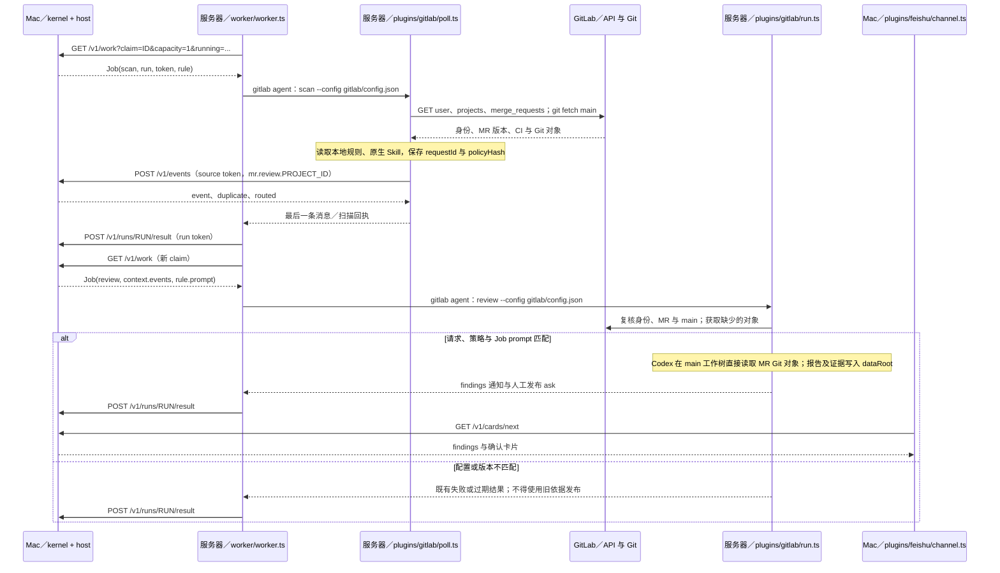
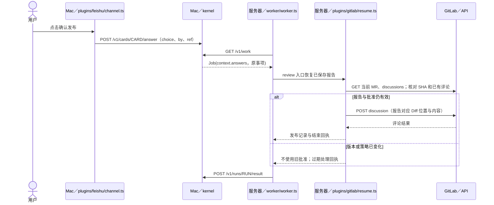
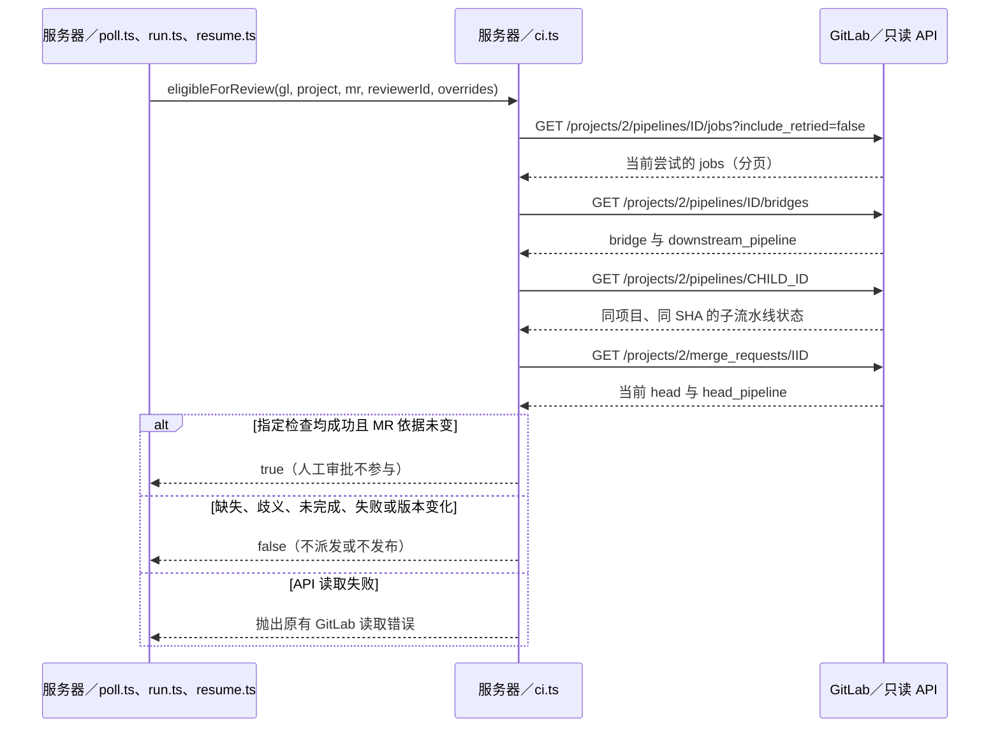

# 开发服务器接入远程审查 Worker

状态：已定稿，实施中（2026-11-05）。中台与通知通道留在 Mac；服务器 `192.168.1.139:2222` 运行 `ek001-139` Worker，首期只审查 EK001（项目 ID 2）。采用 Mac 发起的 SSH 反向隧道。用户已确认使用 shenyue 下的独立目录并复用现有 Codex/glab 登录，不新增账号级权限隔离；验收使用 MR !790，仅生成报告，真实评论写入仍需单独授权。

实现比较基线：`d2eaa48`（当前 origin/main）；最初设计比较基线为 `8537292c582e4d5b1ad910f68baf0bfa5c1f43fe`。本次交付包含测试、部署说明与授权范围内的实例接入，不修改 MR 代码、不迁移生产记录。历史探查记录按发生时保留，当前执行范围以上述定稿内容为准。

## 需求与验收

目标：让目标 GitLab 项目的扫描与代码审查在开发服务器执行，复用 Mac 中台的派单、记录、卡片和人工确认。其他项目仍可在 Mac 执行。

不做：自动修复、提交代码、创建修复 MR、合并、发布、运行 MR 测试；不建设配置分发服务、共享文件系统或第二套调度。首期“只审查”保留既有人工确认发布审查评论的流程，禁止自动发布评论；真实评论写入验收需单独指定测试 MR 并授权。

| 需求 | 条件与触发行为 | 可验证的通过标准 |
|---|---|---|
| R1 远程执行 | 中台派发目标项目的扫描和审查 | 两者只由指定服务器 Worker 执行；Mac 保留中台和既有通道 |
| R2 审查一致性 | 服务器扫描、审查同一 MR | 使用同一服务器上的请求记录、main、原生 Skill 和模型配置；报告记录实际 SHA、prompt 与执行依据 |
| R3 只做审查 | MR 包含代码、配置、hooks 或指令文件 | MR 仅导出为资料，不检出或执行；日常开发目录无变化，不生成修复提交或部署动作 |
| R4 人工确认评论 | 审查产生 findings，用户随后回答 | 未批准不发评论；确认后在原服务器复核版本与报告，条件变化不使用旧批准 |
| R5 断线恢复 | Mac 离线、Worker 重启或网络中断 | 不另起本地替代审查；已落盘结果重连后上交，任务恢复复用现有执行记录 |
| R6 停止与并发 | 停止任务或扫描与审查同时排队 | 服务器 capacity=1；停止按既有 Worker 进程组规则执行，确认结束后交回执 |
| R7 配置一致 | Hub prompt 与服务器规则副本不一致 | 审查拒绝执行，不悄悄用旧 prompt；修复配置后再恢复 |
| R8 单一归属 | 将既有项目切到服务器 | 不同时运行两个扫描入口；待确认报告不遗失、不拿 Mac 报告冒充服务器报告 |

## 目标架构与影响范围



[打开 SVG 原图](remote_review_worker.svg)。橙色区域表示迁到服务器的执行与数据，Mac 保留交互和中台。

中台拥有事项、轮次、卡片与事实日志；服务器拥有扫描请求、审查报告、发布记录、Git 缓存和 Worker 执行记录。飞书连接与凭据仍在 Mac。



源码定位：[Worker](../../worker/worker.ts)、[启动器](../../host/up.ts)、[GitLab 插件](../../plugins/gitlab/agent.ts)、[规则核对](../../plugins/gitlab/instructions.ts)、[扫描](../../plugins/gitlab/poll.ts)、[审查](../../plugins/gitlab/run.ts)、[发布恢复](../../plugins/gitlab/resume.ts)、[原生配置指纹](../../plugins/gitlab/native.ts)。图中没有拟新增业务模块。

### 最小完整范围

- Mac：为目标服务器创建独立 Worker 密钥；目标项目的 scan/review Agent 指向该 Worker；规则 cwd 使用服务器路径。中台地址须可经选定的受保护连接访问。
- 服务器：安装与 Mac 对齐的程序版本、Node 24+、Git、glab、Codex；配置原生 Skill 和登录；准备私有数据目录、裸缓存、规则副本和 Worker 服务。
- 扫描和审查必须同机、同运行账号、同配置及 dataRoot。扫描会读取 nativeBasis、准备可信 main 并保存请求；只迁移 review 会使请求不可见、策略指纹可能不同，不能当成已支持的部署方式。
- 服务器 capacity=1，使扫描更新 main 工作树与审查不能同时发生。人工 `gitlab scan` 绕过 Worker 排队，运行期间禁止直接启动；需要手动指定 MR 时先确保服务器没有在跑的 scan/review，再执行。
- 不修改 `kernel/`、HTTP 协议或 GitLab 业务状态机；经用户确认，GitLab 插件增加按指定自动检查判断的 CI 模式，人工审批不阻止开始审查。部署资料补入 `docs/gitlab-review.md`；后续若补远程集成场景，优先扩展已有 `tests/gitlab-integration.test.ts`。

用户已选择最小改动；集中迁移中台、共享报告存储、自动配置分发会增加本期不需要的生命周期与协议，不作为并行实施方案。未来修复任务可增加独立 Agent 和独立可写目录，不能复用本期会更新到 main 的审查目录；本期不预先增加修复字段。

## 交互过程

### 定时扫描后在服务器完成审查

Mac 的 cron 到期产生扫描任务；服务器依次扫描与审查，图中省略的 JSON 定义见下方协议引用。



### 用户确认后发布评论

用户批准报告后开启新一轮，确认不占住服务器进程；保留既有 GitLab 评论发布语义。



### Mac 断线、Worker 重启和停止

| 场景 | 现有行为与部署约束 |
|---|---|
| Mac 休眠或网络断开 | 不能领新活或接收新确认。已经启动的业务可能继续；Worker 将已完成结果落盘，恢复连接后上交。不能承诺 Mac 离线仍持续调度 |
| Worker 进程重启 | 从本机 worker/runs 恢复跟踪，不删除该目录，不因重启另开同一审查 |
| 服务器失联 | 内核保留任务，按协议的离线提醒处理；不得为提速改派 Mac 并同时运行 |
| 用户停止 | POST /v1/runs/RUN/cancel；Worker 后续领活响应收到 cancel，先停进程组，10 秒后必要时强杀，确认结束后提交 cancelled |
| 断线期间请求停止 | 服务器收到中台取消指令后才会停止，不声称即时远程撤销 |
| 已发出的评论 | 停止不能撤回；已有发送结果不明的记录按 resume.ts 读回，不盲目重发 |

## 交互协议与部署配置

### Worker 接入与上交结果

使用现有 [来源、Agent、通道及失败协议](../protocol.md) 和 [客户端签名](../../protocol/client.ts)，不新增请求字段、错误码或响应封装。Job 完整类型在 [protocol/job.ts](../../protocol/job.ts)，结果校验在 [protocol/validate.ts](../../protocol/validate.ts)。

| 功能 | 发送方 → 接收方 | 入口与鉴权 | 调用约束与响应 |
|---|---|---|---|
| 领取、心跳、取消 | 远程 Worker → Mac | GET /v1/work；Bearer Worker 密钥；无 body | query claim 为稳定领取 ID；running 为运行轮次，capacity=1，wait 最多 50 秒；响应 job 或 null、cancel 列表；响应丢失重用 claim |
| 执行开始 | 远程 Worker → Mac | POST /v1/runs/:run/started；Bearer 本轮 token | body session、link 按既有定义；token 不可操作其他轮次 |
| 交结果 | 远程 Worker → Mac | POST /v1/runs/:run/result；Bearer 本轮 token | body Result；成功返回 rejected；同 token 同内容重放，不同内容 409；结果先落盘再发送 |
| 投递审查事件 | 服务器 poll.ts → Mac | POST /v1/events；Bearer gitlab 来源密钥 | body id/type/subject/summary/detail/link；200 的 routed 必须恰好一条，否则不算成功排队 |
| 回答卡片 | Mac 通道 → Mac | POST /v1/cards/:card/answer；Bearer 通道密钥 | body choice/by/ref，核验回答者及原消息；服务器无需通道密钥 |

上述接口其余 Header 为发送 JSON 时的 Content-Type: application/json；path 仅含表中标识，无其他 query/body。鉴权失败不得换用 owner 密钥绕过，修正凭据后恢复；临时连接失败由现有 Worker 或扫描流程处理，不新建重试队列。

### 配置文件与所有权

服务器示例 `config.json`（字段值为部署示例，不表示已建好连接）：

```json
{
  "url": "http://127.0.0.1:13000",
  "worker": { "name": "ek001-139", "key": "REPLACE_WITH_WORKER_KEY", "capacity": 1 }
}
```

该 URL 假设通过加密隧道映射到 Mac 的现有 Hub。服务器不配置 hub、channels、owner；不得把 Mac 的 config.json 原样复制。`join` 会写整个配置，只在新建服务器实例时使用。Worker 密钥由 Mac 的 `agent-autoloop key new worker ek001-139` 创建，配置写入私有文件，示例密钥不可直接使用。

| 配置位置 | 含义与约束 |
|---|---|
| Mac rules.json | 唯一编辑源；仅目标项目 scan/review 的 agents.worker 改为 ek001-139；目标规则 cwd 是服务器绝对路径 |
| 服务器 rules.json | 从上述规则部署的只读副本，不单独维护第二份业务策略；插件本地读取它，但服务器不运行 Hub |
| 两端 Agent command | `["scan", "--config", "gitlab/config.json"]` 或 `["review", "--config", "gitlab/config.json"]`；使用相对路径，分别按本机 AGENT_AUTOLOOP_HOME 解析 |
| 服务器 gitlab/config.json | 沿用 [完整配置定义](../gitlab-review.md)；hubUrl 与 Worker url 一致；只包含归属本服务器的项目；publication=manual；EK001 使用下述 checks 模式，其他项目保持既有 CI 设置 |
| model / effort | 从 GitLab 配置读取，不硬编码新型号；Codex 及 glab 使用服务器可执行程序绝对路径，避免服务 PATH 与交互 shell 不同 |
| sourceKeyPath | 服务器私有 gitlab 来源密钥文件，0600；不是 Worker token 或 owner token；沿用来源身份，不改变事件类型 |
| dataRoot / cachePath | 服务器持久磁盘，独立于程序 app；不指向开发者工作目录；每项目一份裸缓存与派生审查目录 |
| 原生 Skill | 在服务器运行账号下安装规则指定的 Skill；不依赖 Mac 绝对路径或桌面工具；缺必需能力不得报告零 findings |

现有 instructionsFromRules 校验项目恰好匹配一条 review 规则，以及插件、command、配置路径和 prompt；checkJobRule 再比对本轮名称与 prompt。它不是完整 rules.json 哈希校验，因此部署时必须同时检查 worker、cwd 和命令，不能把运行时核对说成完整配置同步。

变更 prompt 或路由时，先暂停目标扫描并完成活动轮次，再部署两端一致的规则，核对后恢复。首期人工部署，无自动同步服务；无须把 secrets.env 或其他机器的认证文件同步到服务器。

### 仓库内直接审查

用户确认去掉整库文字快照，不设置仓库大小上限。可信 main 工作树仍由 trustedRules 准备；objects.ts 验证 base/start/head 的十六进制 SHA，缺失时从可信 origin 获取 Git 对象，失败直接抛错。run.ts 仅保存 MR 上下文 JSON（schema、gitDir、projectId、mrIid、title、description、baseSha、startSha、headSha），不生成 files/、index.json 或 changes.txt。

Codex 仍使用原生配置及 Skill，在该 main 工作树通过 `codex exec --json --output-schema ... -o ... -` 执行审查，直接使用固定 Git 对象比较指定 base/head、按需读取文件，不检出 MR。模型结果仍为 complete、executionIssue、findings；资源或必需能力不足时报告执行失败。prompt 不包含 MR 标题、描述或正文，只包含可信规则及资料位置。报告、审计、卡片和发布前复核的协议不变；policyHash 标识更新使旧读取方式的报告和批准失效，不迁移历史事实。

### EK001 自动检查与人工审批分开判断

用户已确认：自动检查通过即可开始审查，人工审批未完成不阻止审查；不修改 EK001 的 CI 脚本、审批或合并门槛。最小完整改动是在 GitLab 插件内提供项目级配置，扫描、审查开始/完成、回答接续与逐条评论发布前共用 `plugins/gitlab/ci.ts`。不建设独立 CI 服务，也不修改中台 Job。

EK001 项目配置增加以下字段，名称来自可信 main 的 `.gitlab-ci.yml`，不是 MR 中的配置：

```json
{
  "id": 2,
  "ciMode": "checks",
  "ciJobs": ["check_squareline_sync", "build_code", "host_gate"],
  "ciBridges": ["trigger_board_gate"]
}
```

| 字段 | 约束与兼容 |
|---|---|
| ciMode | 增加 checks；required / confirmed-none / allow-skipped 及默认值不变 |
| ciJobs | checks 模式必填非空、不重复的精确 job 名称数组，元素不得为空或带首尾空白；其他模式不允许此字段 |
| ciBridges | checks 模式可选，缺省为空数组；不重复的精确 bridge 名称，约束同 ciJobs；这里只支持同项目子流水线 |
| 策略摘要 | checks 模式将两个名称列表纳入 policyHash；CI 配置变化使旧报告与批准失效；名称列表只加入 checks 模式，读取策略统一升级的失效规则见前节 |

当前 MR 必须仍为 opened、非 draft，且本人仍为 reviewer。checks 模式要求 head_pipeline ID 为正整数、SHA 等于当前 MR head；逐项检查 jobs 与 bridges 的 commit SHA、所属 pipeline ID 和 success。要求的名称不存在或不唯一、failed/canceled/skipped/manual/running/pending 均不放行；即使 allow_failure=true，显式列入要求的检查也必须成功。只判断配置列出的检查，新增或改名的 CI 必须同步维护可信配置。

jobs API 使用 `include_retried=false`，取各 job 当前尝试；不以旧的成功尝试覆盖新失败。bridge 成功只代表触发成功，还要读取其 downstream_pipeline 的真实状态，核对同项目、同 SHA、相同 ID 和 success。最后重读 MR，确认最新 head_pipeline ID 与 head 未变化；接口失败不能冒充通过，不新增轮询或重试队列。未列入门槛的人工审批不参与判断，不触发、取消或重试任何 GitLab job。

MR !790 的实测依据：当前 head 为 `5bcff83c86531c24ebe81934f802f14df5382644`，父 pipeline 6018 因 verify_multiple_approvals 取消而为 canceled；build_code、check_squareline_sync、最新 host_gate 均成功，trigger_board_gate 对应子 pipeline 6022 成功。本次验收不使用 --override ci。



外部接口均通过既有 GitLab/glab 身份，只使用 GET，无 body 与附加 Header；projects/ID、pipeline ID、MR IID 来自可信项目与已核对的 API 数据，分页沿用 `GitLab.list`。读取字段为 jobs/bridge 的 name、status、commit.id、pipeline.id，bridge 的 downstream_pipeline.id/project_id/sha，子 pipeline 的 id/project_id/sha/status，以及 MR 的 head_pipeline、sha、state、draft、reviewers。GitLab.list/get 的非 200、网络和限流处理见 [api.ts](../../plugins/gitlab/api.ts)，正式接口见 [Jobs API](https://docs.gitlab.com/api/jobs/) 与 [Pipelines API](https://docs.gitlab.com/api/pipelines/)。本实例已实测支持 bridges；不因新版接口改名而引入猜测式降级。

配置属于 GitLab 插件对部署者的新增契约；旧插件不能识别 checks，因此先升级两端到支持版本，再部署 EK001 配置。撤回新模式时先停扫描并排空轮次，改回 required 后重新扫描，不复用 checks 下的批准。其他项目无须适配。

### 网络与服务运行

接入必须提供“服务器能访问 Mac Hub”的通道；只证明 Mac 可以 SSH 到服务器还不够。

采用 Mac 建立 SSH 反向隧道，将服务器回环地址的 13000 端口转发到 Mac Hub 的 `127.0.0.1:3351`。只绑定服务器回环地址，不把 Hub 裸 HTTP 暴露到公网。隧道由系统服务维护，重连不属于内核。2026-11-05 已验证服务器收到 Hub 的鉴权响应，并安装独立 launchd 隧道服务；只绑定服务器回环地址。

Linux 可复用 [host/service.ts](../../host/service.ts) 的 systemd 用户服务；必须实际验证用户退出登录后仍运行，不能把用户服务安装成功当作常驻证明。已核实的依赖、认证和用户会话条件见下方探查记录；不假设服务器已有 Mac 的 Skill、MCP 或桌面连接。

现有 GitLab 插件使用 Codex 原生配置，不额外提供系统沙箱。“只读审查”是任务约束。首期经用户确认使用现有 shenyue 账号下的独立目录减少与开发环境交叉，不赋予生产部署权限；不承诺该插件隔离了账号能读取的所有秘密。

## 接入与回退

1. 使用上述已确认的服务器、连接方式、账号与 EK001 项目；安装相同程序版本与运行依赖，准备服务器本地配置、Skill、缓存及规则副本。此时不启用目标扫描。
2. 对已有项目，先暂停 Mac 上该项目的扫描并排空 review；有未回答发布卡、未完成请求或结果不明的评论时先在原 Mac 流程收尾，不直接改 worker。其他项目继续运行。
3. 同一项目仅保留一个活动扫描入口。已有扫描 Agent 包含多个项目时，将目标项目从原配置分出，为其建立独立扫描 Agent/规则；不复制原扫描使两端重叠。
4. 初次远程运行重新扫描、重新计算服务器的策略指纹。不搬用旧批准，不复制正在运行的 worker/runs；Mac 旧报告保留供查阅。新环境指纹可能触发重审，这是预期行为。
5. 运行 `agent-autoloop gitlab check`、`agent-autoloop check`，核对来源身份、原生 Skill、网络和目标 Worker 在线。前者不联网也不验证模型能力，不能单独作为通过依据。
6. 使用获准的测试 MR 验收审查，再启用目标定时扫描。远程手工入口仍是 `agent-autoloop gitlab scan --mr <MR链接>`，只在无活动任务时使用；必须以实际中台记录确认成功，不能只看 shell 退出码。

回退同样先暂停扫描、排空远程轮次并处理待确认卡，再将规则与项目归属恢复 Mac；服务器报告与发布记录保留。禁止在远程轮次尚未结束时仅改 worker 期待任务迁移：已领取 Job 保留原执行配置。

## 验收矩阵

下表列出验收入口；本地及真实运行结果见交付证据。双实例行为由独立 HOME/进程测试证明，真实服务器和模型另行实测。

| 功能／场景 | 级别 | 执行入口 | 通过标准与证据 |
|---|---|---|---|
| 远程领活与人工回答回到原 Worker | L1 | tests/gitlab-integration.test.ts 与 tests/worker.test.ts：Hub 与 Worker 使用独立临时 HOME | 目标 worker 收到 scan/review，answers-only 从服务器报告恢复；保留 run、worker 与请求记录路径 |
| 扫描与审查使用同一依据 | L1 | tests/gitlab-native.test.ts、tests/gitlab-instructions.test.ts；tests/gitlab-integration.test.ts 双 HOME 场景 | 改服务器 Skill 或 prompt 会使旧依据失效；Mac 不需要目标仓库缓存；保留测试名与退出码 |
| 只读 Git 对象及目录安全 | L1 | tests/gitlab-objects.test.ts、tests/gitlab-worktree.test.ts、tests/gitlab-integration.test.ts | MR 指令不作为规则；脏审查目录拒绝覆盖；开发目录无变化；保留测试断言与退出码 |
| 人工确认后才发布且旧批准失效 | L1 | tests/gitlab-review.test.ts、tests/gitlab-publish.test.ts、tests/gitlab-answer.test.ts | 使用假 GitLab；确认前无写入，版本变化不发布，响应丢失不重复发；保留请求日志 |
| 断网、重启与结果恢复 | L1 | tests/worker.test.ts；tests/worker.test.ts 双进程 Hub 断开场景 | 结果在服务器落盘，重连不重做业务；保留 run ID、调用计数和回执 |
| 停止进程组与 capacity=1 | L1 | tests/worker.test.ts | 子进程全部结束后上报取消，扫描与审查最多一轮执行；保留测试名与退出码 |
| 自动检查与审批分离 | L1 | tests/gitlab-ci.test.ts、tests/gitlab-integration.test.ts | 父审批取消不阻止已通过检查的审查；缺失、歧义、失败、跳过、旧 SHA、查询期间切换 pipeline 和子流水线失败不放行；批准后子流水线失效不写评论 |
| 服务器真实运行环境 | L3 | 服务器 gitlab check、check、service install；Mac status；服务日志 | 相同程序版本、账号与 Skill 可用，断开管理登录后仍可领活；记录版本、worker 名和服务状态，不保存密钥 |
| 实际远程审查 | L3 | 获准测试 MR 的 gitlab scan --mr；Mac status 与服务器审计报告 | 报告关联实际 main/MR SHA、prompt 与模型结果；Mac 无本地审查进程；真实服务和模型证据齐全 |
| 单项目切换与恢复 | L3 | 维护窗口核对两端规则、配置、status 和请求记录 | 同一项目仅一个活动扫描入口，切换前无未收尾轮次或批准，回退无并行执行；保存脱敏配置差异 |

用户已指定 !790 验收并确认复用 Mac 现有飞书通道；不新增服务器通道。真实 GitLab 评论写入仍须人工批准。自动测试使用假 CLI、假 HTTP 和临时 HOME，不新增真实事件监听。

## 交付状态与待确认

当前分支 `codex/remote-review-worker`，交付进行中；提交与 PR 以最终证据报告为准。用户已确认取消整库文字快照，直接在仓库启动 Codex 读取指定 Git 对象；不设仓库大小上限，资源不足明确报错。两端已部署相同运行内容，真实审查已通过；最终提交来源、PR 和 CI 结果以交付报告为准。

| 项目 | 当前事实与证据 |
|---|---|
| 网络 | Mac 的 SSH 反向隧道服务已运行，服务器 127.0.0.1:13000 连接 Mac 127.0.0.1:3351；未带密钥请求收到 Hub 401 |
| 服务器隔离 | SSH 进入 shenyue 的 LXC 环境；用户确认复用该账号和登录，只使用私有目录，不新增账号级隔离 |
| 依赖 | 私有 Node v24.22.2，官方 SHA256 验证通过；原 Node v22.23.2、current 链接和 shell 配置未修改。既有 Codex 0.166.0、glab 1.117.0 未升级 |
| 存储 | 用户授权删除两个干净且提交已包含在 main 的旧 worktree，释放 9.51 GiB；未清理有活动进程或未保存资料的副本。其后安装独立裸缓存与完整 main 审查树，可用空间约 7.3 GiB |
| Worker | systemd 用户服务在线，capacity=1；仅本用户启用 linger；已撤回本次额外 CPU/内存配额，不改其他用户服务 |
| 路由 | Mac 增加独立 ek001-review / ek001-scan，APP 配置保留；两端规则副本一致。EK001 已启用每 5 分钟 cron，scan/review 均归属 ek001-139，capacity=1；APP 路由与接入前备份逐项一致 |
| 程序版本 | 两端已安装同一工作区构建，运行内容摘要一致；最终提交后仍需部署相同已提交版本并复验 |
| 本地验证 | 最终 npm test 385 项通过；typecheck、format:check、安装到卸载冒烟通过。此前 nightly 强杀/变异/预算检查通过，之后未改内核与模拟器；独立审查 1 轮，findings 为空 |
| 真实 CI 判断 | !790 head 为 5bcff83c86531c24ebe81934f802f14df5382644，父 6018 因人工审批取消，指定自动检查及板端子 6022 成功；eligibleForReview 返回 true，未使用 override |
| 真实远程审查 | run 289 完成；gpt-6.1-sol 于 2026-11-05 12:09:23–12:12:54（Asia/Taipei）实际执行，complete=true，2 条 findings。审计 codex-BrSaMz；报告摘要 74ce87c555a5dcca3d98a927ed020945d7aafc1a3d5be844044c8660408bbc98；main/MR SHA 与上文实测一致 |
| 旧快照失败已解除 | 首次 run 286 在原 128 MiB 限制处失败并已取消重试；新实现直接读取 Git 对象，未生成整库文字副本，专用 main 工作树保持干净 |
| 通道与评论 | Mac 原飞书通道已送达确认卡 #16，delivery 有 ref 且 error=null；服务器无通道。GitLab 写入动作记录为 0，未代替用户回答 |
| 单一归属与回退前提 | EK001 是新增接入，接入前 Mac 没有该项目，因此既有项目迁移/回退场景不适用；已实测两端规则一致、仅一条 scan、均派给 ek001-139；删去新增路由可还原接入前配置，未干扰待确认卡做真实回退 |

已采用的简化是删除整库文字转换：objects.ts 只准备固定 base/start/head 的 Git 对象，run.ts 传入 Git 目录和版本 JSON，Codex 在可信 main 工作树中按需读取完整对象。保留 MR 指令隔离和原有结构化报告接口，不检出或运行 MR。取消原 128 MiB 总量限制；磁盘、对象读取或模型运行不足时按实际失败处理，不截断。策略标识升级至 native-git-objects-v4，旧报告和批准不混用。Mac 和 Linux 部署相同实现。

部署前的逐次探查、已删除 worktree 的完整提交、配置备份和预检记录保存在本人私有部署目录，不包含在仓库。模型真实报告已验证，日常扫描已启用；最终安装来源与远端 CI 由交付报告记录。真实评论写入未验收，保留人工批准边界。
